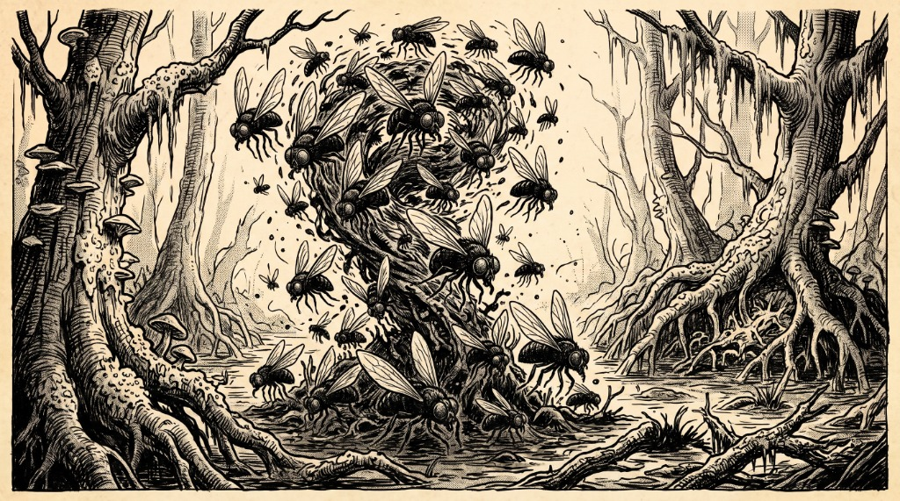

  
Manifestação do Enxame

  

    
    
A Manifestação do Enxame

  

  <table>
    <tr><td><b>Tipo</b></td><td>Manifestação divina rara</td></tr>
    <tr><td><b>Praticantes</b></td><td><a href="../Tribos/Masca-Musgo" class="internal">Masca-Musgo</a></td></tr>
    <tr><td><b>Ligação Espiritual</b></td><td><a href="../Cosmologia/Nyog'Sothep" class="internal">Nyog'Sothep</a></td></tr>
    <tr><td><b>Local / Uso</b></td><td>Rituais solenes e profanações graves</td></tr>
    <tr><td><b>Status</b></td><td>Raro</td></tr>
  </table>

# A Manifestação do Enxame

<blockquote class="epigraph">*A preencher.*</blockquote>

Na **Manifestação do Enxame**, [[Cosmologia/Nyog'Sothep|Nyog'Sothep]] — normalmente disperso pela rede invisível do micélio subterrâneo e pelos esporos que flutuam na umidade — condensa sua presença em um único ponto do [[Geografia/Vale da Lama|Vale da Lama]]. É o mais próximo de um rosto visível que o Deus Fúngico concede aos mortais, e ninguém o testemunha sem sentir o peso do solo sob os joelhos.

## Natureza e Funcionamento
O fenômeno é raro e nunca ocorre por capricho. Durante rituais solenes de grande peso ou diante de profanações graves contra o ciclo da decomposição, a água parada estremece e uma nuvem cerrada de **moscas negras e dourado-metálicas** brota da lama úmida, das frestas das cascas e das raízes submersas.

O enxame não se espalha ao vento como insetos comuns: ergue-se em coluna densa e fechada, escurecendo o ar úmido com reflexos de bronze sujo, enquanto produz um zumbido grave e contínuo que parece nascer dentro do crânio e reverberar pelos ossos de quem está por perto.

## Origem e Tradição
A própria imagem da mosca entalhada em minúcia sobre a boca aberta de um sapo no [[Cosmologia/Idolo de Nyog'Sothep|Ídolo de Nyog'Sothep]] ecoa essa ligação antiquíssima entre o Deus Fúngico e os enxames que devoram e devolvem a carne ao brejo.

## Prática e Tabus
Quando a nuvem se ergue em [[Geografia/Raiz-Funda|Raiz-Funda]] ou sob as arcadas do [[Geografia/Jardim Dourado|Jardim Dourado]], toda conversa cessa de imediato e até os sacerdotes mais antigos abaixam a cabeça em silêncio absoluto. Ninguém ergue a mão para espantar os insetos, pois o gesto seria insulto aberto diante da divindade. Para os devotos, ser tocado pelas asas frias do enxame sem levar picadas é sinal raríssimo de bênção — uma aprovação silenciosa que marca o escolhido por anos.

## O que se Conta pelo Pântano
- **O Zumbido nos Ossos:** Quem já ficou diante da Manifestação do Enxame conta que o som não entra só pelos ouvidos — faz vibrar os dentes, o peito e cada junta do corpo, como aviso implacável de que nada no vale escapa à rede do micélio.
- **Silêncio de Ferro:** Veteranos de Raiz-Funda dizem que, antes mesmo de a primeira mosca romper a turfa, os sapos e aves do mangue calam de golpe, deixando no ar apenas o cheiro doce de folha podre.

---

**Veja também:** [[Cosmologia/Nyog'Sothep|Nyog'Sothep]] | [[Cosmologia/Idolo de Nyog'Sothep|Ídolo de Nyog'Sothep]] | [[Geografia/Jardim Dourado|Jardim Dourado]] | [[Tribos/Masca-Musgo|Masca-Musgo]]
