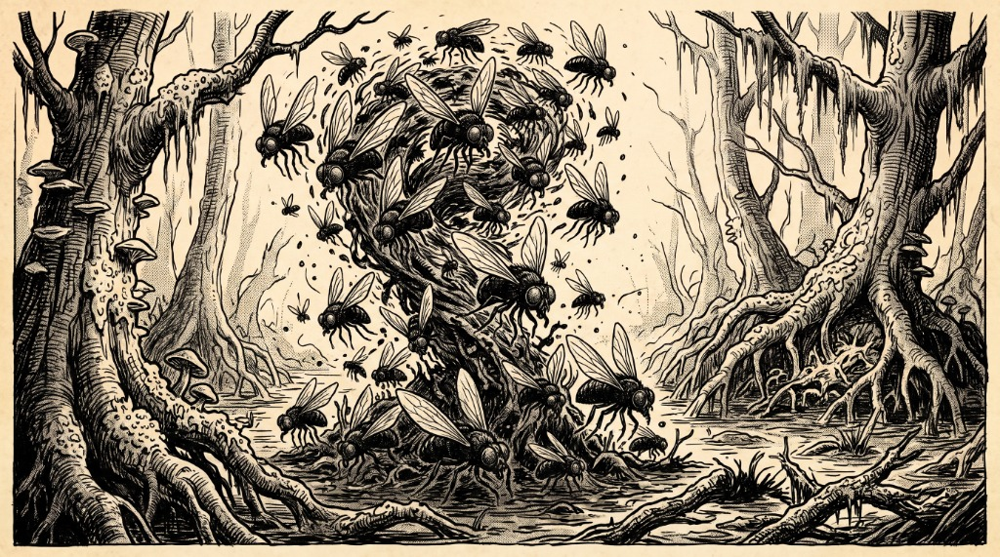

  
Nyog'Sothep

  

    
    
A Manifestação do Enxame de Nyog'Sothep

  

  <table>
    <tr><td><b>Tipo</b></td><td><a href="../Cosmologia/Deus-Verdadeiro" class="internal">Deus Verdadeiro</a> (Fúngico)</td></tr>
    <tr><td><b>Epíteto</b></td><td>Deus Fúngico</td></tr>
    <tr><td><b>Domínio</b></td><td>Decomposição, Fermentação, Esporos</td></tr>
    <tr><td><b>Manifestação</b></td><td>Enxame de moscas negras e dourado-metálicas</td></tr>
    <tr><td><b>Santuário</b></td><td><a href="../Geografia/Jardim-Dourado" class="internal">Jardim Dourado</a></td></tr>
    <tr><td><b>Símbolo</b></td><td><a href="../Cosmologia/Micelio-Dourado" class="internal">Micélio Dourado</a></td></tr>
    <tr><td><b>Adoradores</b></td><td><a href="../Tribos/Masca-Musgo" class="internal">Masca-Musgo</a></td></tr>
    <tr><td><b>Clero</b></td><td><a href="../NPCs/Sacerdote-Chefe-Malok" class="internal">Malok</a>, <a href="../NPCs/Zog" class="internal">Zog</a>, <a href="../NPCs/Irmãos-Snakk-e-Drig" class="internal">Snakk e Drig</a></td></tr>
  </table>

# Nyog'Sothep

<blockquote class="epigraph">"Toda criatura viva carrega apenas um empréstimo temporário de matéria."</blockquote>

**Nyog'Sothep** é o **[[Cosmologia/Deus Verdadeiro|Deus Verdadeiro]]** dos [[Tribos/Masca-Musgo|Masca-Musgo]], a força fúngica primordial do [[Geografia/Vale da Lama|Vale da Lama]] ligada à decomposição, à fermentação e ao renascimento. Para seus devotos, é ao mesmo tempo o libertador que minou os Dragões Vermelhos e a lei silenciosa que, cedo ou tarde, reclama toda carne de volta ao solo.

## Aparência
Como Deus Verdadeiro, **não tem forma física definida** nem **age de maneira direta no plano físico** — ao contrário dos [[Deuses-Fera/Deus-Fera|Deuses-Fera]], que transitam com facilidade entre o etéreo e o físico. Não mantém trono, rosto esculpido nem corte de avatares, tampouco comanda Deuses-Fera menores em seu nome. Para o clero de [[Geografia/Raiz-Funda|Raiz-Funda]], Nyog'Sothep é vasto demais para caber em um corpo: sua presença corre pela rede subterrânea de micélio, pelos esporos e pelo [[Cosmologia/Micelio Dourado|Micélio Dourado]], desmanchando madeira, osso, pele e escama velha para alimentar o brejo.

Em ocasiões raras — durante rituais solenes ou diante de profanações graves — o deus condensa sua presença na **[[Cosmologia/Manifestacao do Enxame|Manifestação do Enxame]]**: uma nuvem fechada de moscas negras e dourado-metálicas que brota da lama úmida e das frestas das cascas, vibrando num zumbido grave que ressoa dentro dos ossos.

## Personalidade e Maneirismos
Não é um deus da morte estéril, mas da **digestão sagrada**. Na fé do Oeste, toda criatura viva carrega apenas um empréstimo temporário de matéria. Quando um corpo morre, Nyog'Sothep cobra o que é seu pelo bolor, pela larva e pelo esporo. Cremar um cadáver ou trancá-lo em pedra seca longe da umidade equivale a roubo cósmico — tentativa arrogante de negar ao pântano o alimento devido. Por isso, a devoção dos Masca-Musgo mistura gratidão pela liberdade conquistada e temor diante de uma entidade que não negocia em termos mortais.

## História
Nas minas das [[Geografia/Montanhas do Oeste|Montanhas do Oeste]], goblins escravizados acharam o [[Cosmologia/Idolo de Nyog'Sothep|Ídolo de Nyog'Sothep]] e o primeiro [[Cosmologia/Micelio Dourado|Micélio Dourado]]. Ao longo dos vinte anos da [[Historia/A Grande Morte Lenta|Grande Morte Lenta]], os esporos de Nyog'Sothep corroeram os Dragões Vermelhos até a vitória na Batalha da Lua Nova e a consagração do [[Geografia/Jardim Dourado|Jardim Dourado]], em [[Geografia/Raiz-Funda|Raiz-Funda]]. Ainda assim, seu alcance encontra um limite desconhecido: nas [[Geografia/Terras Verdejantes|Terras Verdejantes]], além das [[Geografia/Ruinas dos Sem-Nome|Ruínas dos Sem-Nome]], alguma força barra o avanço do pântano sobre a floresta.

## Função e Ocupação

### Éditos e Anátemas (Pathfinder 2e Remaster)

> [!info] Fé de Nyog'Sothep
> - **Éditos:** Devolver todos os mortos à lama e ao micélio; cultivar fungos úteis; respeitar o ciclo de apodrecimento; rejeitar o fogo como arma de combate, dor ou destruição do solo e da carne.
> - **Anátemas:** Queimar cadáveres ou destruir corpos com fogo; usar fogo em combate ou para causar dor; esterilizar o solo do pântano; servir aos dragões antigos ou profanar o [[Geografia/Jardim Dourado|Jardim Dourado]].

### O Ciclo da Devolução
No [[Geografia/Vale da Lama|Vale da Lama]], nada se perde. Quando um membro da tribo falece, o clero conduz o retorno em três estágios no [[Geografia/Jardim Dourado|Jardim Dourado]]:
1. **O Inchaço (Dias 1 a 3):** O corpo é lavado com água de mangue, despido de metais e couro curtido e deitado na turfa úmida enquanto a carne amolece e o pântano começa a cobrá-lo.
2. **A Floração (Dias 4 a 12):** Hifas esbranquiçadas e filamentos âmbar rompem a pele e os pulmões. Os Coveiros-Sacerdotes ([[NPCs/Irmãos Snakk e Drig|Irmãos Snakk e Drig]]) leem os desenhos do bolor para honrar a memória do morto.
3. **O Retorno (Após o 13º dia):** O esqueleto limpo afunda na turfa ou é recolhido para virar ferramenta. A consciência se dissolve na rede micelial de Nyog'Sothep, incorporada à memória silenciosa do vale.

### O Jardim Dourado
Situado sob as arcadas de mangue no coração de [[Geografia/Raiz-Funda|Raiz-Funda]], o **[[Geografia/Jardim Dourado|Jardim Dourado]]** é o santuário mais sagrado de Nyog'Sothep, protegido pelos [[Tribos/Jardineiros|Jardineiros]] e restrito ao alto clero, decana e curandeiros autorizados.

## Relações e Alianças
* **[[Tribos/Masca-Musgo|Masca-Musgo]]:** Seus principais devotos, liderados espiritualmente por [[NPCs/Sacerdote-Chefe Malok|Malok]], [[NPCs/Zog|Zog]] e pelos [[NPCs/Irmãos Snakk e Drig|Irmãos Snakk e Drig]].
* **[[Deuses-Fera/Krr'tak|Krr'tak (a Espadachim)]]:** Carrega uma dívida antiga com Nyog'Sothep, motivo pelo qual evita matar goblins.

## O que se Conta pelo Pântano
- **O Toque do Enxame:** Nas passarelas de Raiz-Funda, diz-se que ser tocado pela Manifestação do Enxame sem levar picadas é bênção raríssima — mas até os sacerdotes mais antigos baixam a cabeça em silêncio quando o zumbido começa a vibrar nos dentes.

---

**Veja também:** [[Cosmologia/Micelio Dourado|Micélio Dourado]] | [[Cosmologia/Idolo de Nyog'Sothep|Ídolo de Nyog'Sothep]] | [[Geografia/Jardim Dourado|Jardim Dourado]] | [[Cosmologia/Animismo|Animismo]] | [[Cosmologia/Lei da Troca|Lei da Troca]] | [[Cosmologia/Codigo de Honra do Fogo|Código de Honra do Fogo]] | [[Tribos/Masca-Musgo|Masca-Musgo]]
