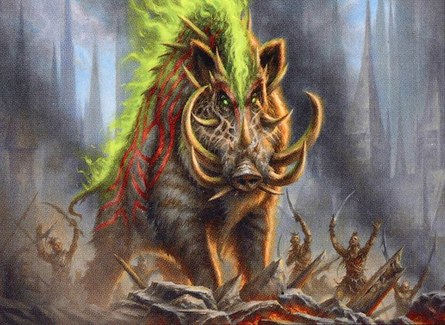

  
Javali de Musgo-Negro

  

    
    
Javali de Musgo-Negro

  

  <table>
    <tr><td><b>Tipo</b></td><td>Fera do pântano</td></tr>
    <tr><td><b>Habitat</b></td><td>Pântano Profundo / [[Geografia/Pocos de Turfa e Brejo do Musgo-Negro|Poços de Turfa]]</td></tr>
    <tr><td><b>Perigo</b></td><td>Médio</td></tr>
    <tr><td><b>Recurso</b></td><td>Presas curvas (carne venenosa)</td></tr>
  </table>

# Javali de Musgo-Negro

## Descrição

O **Javali de Musgo-Negro** é um javali corpulento coberto por um fungo negro espesso e ácido que emerge do pântano profundo à noite, especialmente nas regiões próximas aos [[Geografia/Pocos de Turfa e Brejo do Musgo-Negro|Poços de Turfa e Brejo do Musgo-Negro]].

## Ecologia e Recursos

- **Carne Venenosa:** Sua carne é impregnada pelas toxinas do musgo-negro e imprópria para consumo.
- **Presas Valiosas:** Suas presas curvas e resistentes são muito procuradas pelos artesãos de [[Geografia/Raiz-Funda|Raiz-Funda]] (como [[NPCs/Gnarl Martelo-Torto|Gnarl Martelo-Torto]]) para fabricar armas e ferramentas.

## Ganchos de Aventura

- Caçadores de [[Geografia/Raiz-Funda|Raiz-Funda]] buscam abater um espécime para suprir a forja de presas sem se atolarem nos poços de piche.

---

**Veja também:** [[Geografia/Pocos de Turfa e Brejo do Musgo-Negro|Poços de Turfa e Brejo do Musgo-Negro]], [[Geografia/Vale da Lama|Vale da Lama]], [[NPCs/Gnarl Martelo-Torto|Gnarl Martelo-Torto]]
