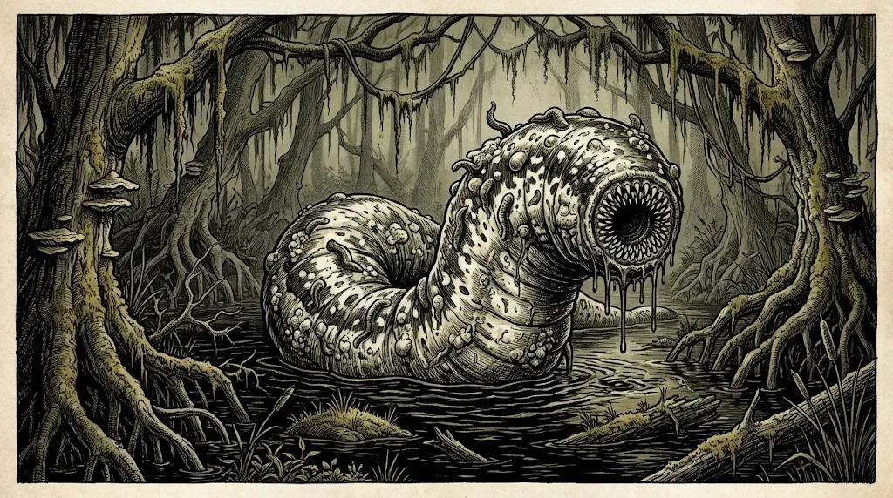

  
Rainha-Sanguessuga

  

    
    
Rainha-Sanguessuga emergindo das águas negras

  

  <table>
    <tr><td><b>Tipo</b></td><td>Fera colossal / Criatura ritual</td></tr>
    <tr><td><b>Habitat</b></td><td>[[Geografia/Aguas Paradas Profundas|Águas Paradas Profundas]] e [[Geografia/Lago da Grande Tirana|Lago da Grande Tirana]]</td></tr>
    <tr><td><b>Perigo</b></td><td>Alto</td></tr>
    <tr><td><b>Vínculo</b></td><td>[[Deuses-Fera/Sss'kar|Sss'kar]] e [[Tribos/Ventre-Inchado|Ventre-Inchado]]</td></tr>
  </table>

# Rainha-Sanguessuga de Águas Paradas

## Descrição

A **Rainha-Sanguessuga de Águas Paradas** é uma sanguessuga gigantesca de pele pálida e boca circular dentada que habita as águas paradas do sul do [[Geografia/Vale da Lama|Vale da Lama]].

## Comportamento e Rumores

Associada aos [[Tribos/Ventre-Inchado|Ventre-Inchado]] e ao culto de [[Deuses-Fera/Sss'kar|Sss'kar]], a criatura foi avistada recentemente próxima ao [[Geografia/Lago da Grande Tirana|Lago da Grande Tirana]], muito além de seu território habitual nas [[Geografia/Aguas Paradas Profundas|Águas Paradas Profundas]].

## Ganchos de Aventura

- Sua migração para o norte levanta temores em [[Geografia/Raiz-Funda|Raiz-Funda]] de que a influência de [[Deuses-Fera/Sss'kar|Sss'kar]] esteja se expandindo para o centro do vale.

---

**Veja também:** [[Deuses-Fera/Sss'kar|Sss'kar]], [[Tribos/Ventre-Inchado|Ventre-Inchado]], [[Geografia/Aguas Paradas Profundas|Águas Paradas Profundas]], [[Geografia/Lago da Grande Tirana|Lago da Grande Tirana]]
