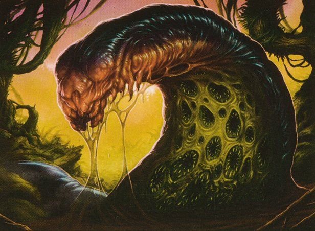

  
Rainha-Sanguessuga

  

    
    
Rainha-Sanguessuga de Águas Paradas

  

  <table>
    <tr><td><b>Tipo</b></td><td>Fera colossal / Criatura ritual</td></tr>
    <tr><td><b>Habitat</b></td><td><a href="../Geografia/Aguas-Paradas-Profundas" class="internal">Águas Paradas Profundas</a> e <a href="../Geografia/Lago-da-Grande-Tirana" class="internal">Lago da Grande Tirana</a></td></tr>
    <tr><td><b>Perigo</b></td><td>Alto</td></tr>
    <tr><td><b>Vínculo</b></td><td><a href="../Deuses-Fera/Sss'kar" class="internal">Sss'kar</a> e <a href="../Tribos/Ventre-Inchado" class="internal">Ventre-Inchado</a></td></tr>
  </table>

# Rainha-Sanguessuga de Águas Paradas

## Descrição

A **Rainha-Sanguessuga de Águas Paradas** é uma sanguessuga gigantesca de pele pálida e boca circular dentada que habita as águas paradas do sul do [[Geografia/Vale da Lama|Vale da Lama]].

## Comportamento e Rumores

Associada aos [[Tribos/Ventre-Inchado|Ventre-Inchado]] e ao culto de [[Deuses-Fera/Sss'kar|Sss'kar]], a criatura foi avistada recentemente próxima ao [[Geografia/Lago da Grande Tirana|Lago da Grande Tirana]], muito além de seu território habitual nas [[Geografia/Aguas Paradas Profundas|Águas Paradas Profundas]].

---

**Veja também:** [[Deuses-Fera/Sss'kar|Sss'kar]], [[Tribos/Ventre-Inchado|Ventre-Inchado]], [[Geografia/Aguas Paradas Profundas|Águas Paradas Profundas]], [[Geografia/Lago da Grande Tirana|Lago da Grande Tirana]]
