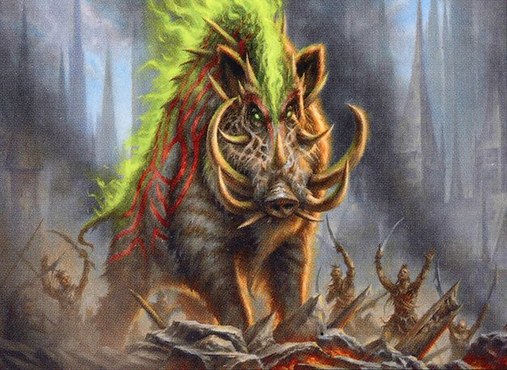

  
Ulok, a Grande Javali

  

    
    
Ulok, a Grande Javali

  

  <table>
    <tr><td><b>Tipo</b></td><td>Criatura / Fera Única</td></tr>
    <tr><td><b>Epíteto</b></td><td>A Grande Javali</td></tr>
    <tr><td><b>Espécie</b></td><td>Javali colossal</td></tr>
    <tr><td><b>Gênero</b></td><td>Feminino</td></tr>
    <tr><td><b>Status</b></td><td>Viva</td></tr>
    <tr><td><b>Local</b></td><td><a href="../Geografia/Terras-Verdejantes" class="internal">Terras Verdejantes</a> (além das <a href="../Geografia/Ruinas-dos-Sem-Nome" class="internal">Ruínas dos Sem-Nome</a>)</td></tr>
    <tr><td><b>Perigo</b></td><td>Alto</td></tr>
  </table>

# Ulok (a Grande Javali)

<blockquote class="epigraph">*A preencher.*</blockquote>

**Ulok**, chamada de **a Grande Javali**, governa os bosques das [[Geografia/Terras Verdejantes|Terras Verdejantes]], logo após as [[Geografia/Ruinas dos Sem-Nome|Ruínas dos Sem-Nome]], já fora do [[Geografia/Vale da Lama|Vale da Lama]]. Carrega um contraste amargo para quem atravessa a fronteira: reina sobre uma terra ligada à cura e à harmonia, mas responde a intrusos com fúria cega.

## Aparência e Anatomia
*A preencher.*

## Personalidade e Maneirismos
Territorial e brutal, Ulok investe ao menor sinal de invasão, sem recuo nem trégua. Quem cruza suas clareiras raramente recebe um segundo aviso antes da carga.

## História
*A preencher.*

## Comportamento e Ecologia
Cria uma ninhada numerosa que espalha sua agressividade pelas matas e ruínas antigas da região, mantendo o território em tumulto constante mesmo longe do brejo ácido de [[Cosmologia/Nyog'Sothep|Nyog'Sothep]].

## Relações e Alianças
* **[[Criaturas/Filhos de Ulok|Filhos de Ulok]]:** Prole numerosa e briguenta que disputa entre si os bosques da mãe.

## O que se Conta pelo Pântano
- **Cura com Presas:** Do lado de cá das Pedras Mortas, diz-se que as Terras Verdejantes curam qualquer ferida — desde que o viajante sobreviva ao encontro com Ulok ou com seus filhotes antes de achar onde descansar.

---

**Veja também:** [[Geografia/Terras Verdejantes|Terras Verdejantes]] | [[Geografia/Ruinas dos Sem-Nome|Ruínas dos Sem-Nome]] | [[Geografia/Vale da Lama|Vale da Lama]]
