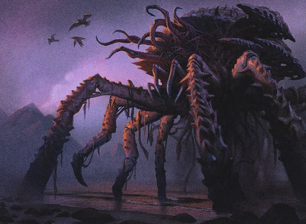

  
Karkinos

  

    
    
Karkinos, o Deus-Caranguejo

  

  <table>
    <tr><td><b>Tipo</b></td><td><a href="../Deuses-Fera/Deus-Fera" class="internal">Deus-Fera</a></td></tr>
    <tr><td><b>Epíteto</b></td><td>O Deus-Caranguejo</td></tr>
    <tr><td><b>Espécie / Forma</b></td><td>Caranguejo colossal escarlate</td></tr>
    <tr><td><b>Gênero</b></td><td>Masculino</td></tr>
    <tr><td><b>Status</b></td><td>Vivo (adormecido sob a costa)</td></tr>
    <tr><td><b>Domínio</b></td><td>Marés, crustáceos e águas salobras</td></tr>
    <tr><td><b>Local</b></td><td><a href="../Geografia/Costa-Salobra" class="internal">Costa Salobra</a> (Nordeste)</td></tr>
    <tr><td><b>Adoradores</b></td><td><a href="../Tribos/Ferve-Alga-(Olhos-Vermelhos)" class="internal">Ferve-Alga (Olhos-Vermelhos)</a></td></tr>
  </table>

# Karkinos (Deus-Caranguejo)

<blockquote class="epigraph">*A preencher.*</blockquote>

**Karkinos**, o **Deus-Caranguejo**, dorme sob os bancos de lodo e salitre da **[[Geografia/Costa Salobra|Costa Salobra]]**, a nordeste do [[Geografia/Vale da Lama|Vale da Lama]]. Mesmo adormecido, sua presença governa o avanço das marés, o ciclo das enseadas de desova e a lei rígida sob a qual vivem os [[Tribos/Ferve-Alga (Olhos-Vermelhos)|Ferve-Alga (Olhos-Vermelhos)]].

## Aparência
Um crustáceo descomunal de carapaça escarlate, olhos rubros incandescentes e pinças largas o bastante para partir ossos e cascos de jangada sem esforço.

## Personalidade e Maneirismos
*A preencher.*

## História
*A preencher.*

## Função e Ocupação
Na Costa Salobra, a rotina dos [[Tribos/Ferve-Alga (Olhos-Vermelhos)|Ferve-Alga]] acompanha a respiração do deus adormecido:
- **Oferendas e Rituais:** Os devotos lançam peixes e crustáceos nas águas salobras, executam danças de garra sob a lua cheia, devolvem seus mortos à maré para nutrir a prole de Karkinos e bebem [[Tribos/Salmoura e Sal Cristalizado|salmoura fervente]] como prova de fé e coragem.
- **Áreas de Desova:** Enseadas rasas da costa guardam os ovos de Karkinos e de seus descendentes. Fora da estação de acasalamento, entrar ali é proibido; durante ela, exige permissão formal dos xamãs da tribo.
- **Ira de Karkinos:** Quem viola esses berçários atrai enxames de caranguejos gigantes, feridas na pele e afogamentos súbitos em águas que mal cobrem o joelho.

## Relações e Alianças
* **[[Tribos/Ferve-Alga (Olhos-Vermelhos)|Ferve-Alga (Olhos-Vermelhos)]]:** Guardiões ferozes de suas enseadas e únicos intérpretes de suas marés na costa nordeste.
* **[[Cosmologia/Nyog'Sothep|Nyog'Sothep]]:** O clero de [[Geografia/Raiz-Funda|Raiz-Funda]] vê em Karkinos um poder preso à matéria e às águas locais, muito aquém de um [[Cosmologia/Deus Verdadeiro|Deus Verdadeiro]]. Ainda assim, a força do Deus-Caranguejo e a vigilância dos Olhos-Vermelhos sustentam uma trégua tensa na fronteira nordeste.

## O que se Conta pelo Pântano
- **[[Criaturas/Pinça-de-Sal|Pinça-de-Sal (Cria de Karkinos)]]** *(Costa Salobra — Perigo Médio)*: Coletores de sal juram que abater um desses caranguejos jovens sem bênção xamânica marca o caçador com o cheiro da costa — e os [[Tribos/Ferve-Alga (Olhos-Vermelhos)|Ferve-Alga]] chegam antes da maré seguinte.
- **A Respiração sob a Lama:** Pescadores da costa garantem que, quando a água recua mais depressa do que o normal, é o grande caranguejo escarlate se ajeitando sob a lama salgada.

---

**Veja também:** [[Deuses-Fera/Deus-Fera|Deus-Fera]] | [[Tribos/Ferve-Alga (Olhos-Vermelhos)|Ferve-Alga (Olhos-Vermelhos)]] | [[Geografia/Costa Salobra|Costa Salobra]] | [[Criaturas/Pinça-de-Sal|Pinça-de-Sal]] | [[Cosmologia/Nyog'Sothep|Nyog'Sothep]]
