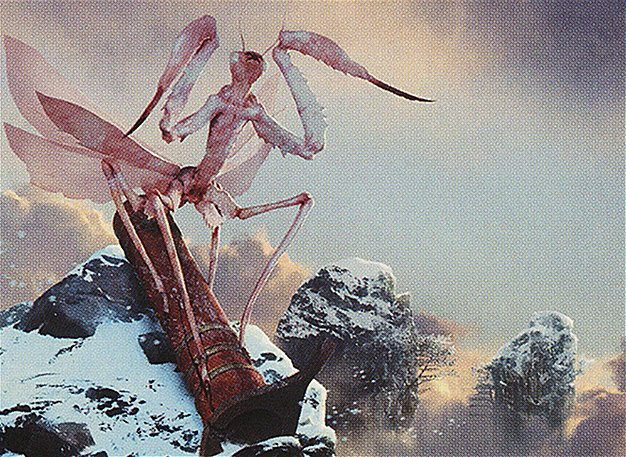

  
Krr'tak

  

    
    
Krr'tak, o Espadachim

  

  <table>
    <tr><td><b>Tipo</b></td><td>[[Deuses-Fera/Deus-Fera|Deus-Fera menor]]</td></tr>
    <tr><td><b>Epíteto</b></td><td>O Espadachim</td></tr>
    <tr><td><b>Forma</b></td><td>Louva-a-deus colossal</td></tr>
    <tr><td><b>Habitat</b></td><td>Raízes de mangue / [[Geografia/Copas da Teia Prateada|Copas da Teia Prateada]]</td></tr>
    <tr><td><b>Perigo</b></td><td>Alto</td></tr>
    <tr><td><b>Culto</b></td><td>Sem tribo devota conhecida</td></tr>
  </table>

# Krr'tak (o Espadachim)

## Descrição

**Krr'tak**, conhecido entre os habitantes do [[Geografia/Vale da Lama|Vale da Lama]] como **o Espadachim**, é um [[Deuses-Fera/Deus-Fera|Deus-Fera menor]] em forma de louva-a-deus colossal, dotado de braços dianteiros em lâmina serrilhada e asas translúcidas.

## Comportamento e Manifestações

- **Trânsito Etéreo:** Assim como [[Deuses-Fera/Og'gath|Og'gath]], Krr'tak não possui uma tribo dedicada a seu culto, mas transita facilmente entre o plano etéreo e o físico rondando as raízes de mangue e as proximidades das [[Geografia/Copas da Teia Prateada|Copas da Teia Prateada]].
- **Sinais de Presença:** Batedores relatam que, momentos antes de o Espadachim surgir, os insetos do brejo calam-se de súbito e um estalo seco — semelhante a duas lâminas batendo uma na outra — ecoa entre os troncos altos.
- **Imobilidade Predatória:** Costuma permanecer imóvel sobre galhos elevados ou marcos de pedra antiga, confundindo-se com a folhagem pálida até desferir um golpe rápido contra presas que invadem seu campo de visão.

## Relação com as Tribos

Nem os [[Tribos/Masca-Musgo|Masca-Musgo]] nem os nômades [[Tribos/Tece-Pele|Tece-Pele]] mantêm pactos com Krr'tak. Para o clero de [[Geografia/Raiz-Funda|Raiz-Funda]], ele é tratado como uma força territorial perigosa que deve ser evitada com silêncio e respeito à distância.

## Ganchos de Aventura

- Batedores de [[Geografia/Raiz-Funda|Raiz-Funda]] e caravanas [[Tribos/Tece-Pele|Tece-Pele]] evitam cruzar o trecho das raízes onde o Espadachim foi visto empoleirado recentemente.
- Um grupo de caçadores encontrou uma presa limpa ao meio com precisão cirúrgica — sinal inequívoco de que Krr'tak voltou a caçar perto das trilhas do noroeste.

---

**Veja também:** [[Deuses-Fera/Deus-Fera|Deus-Fera]], [[Geografia/Copas da Teia Prateada|Copas da Teia Prateada]], [[Geografia/Vale da Lama|Vale da Lama]], [[Tribos/Tece-Pele|Tece-Pele]]
