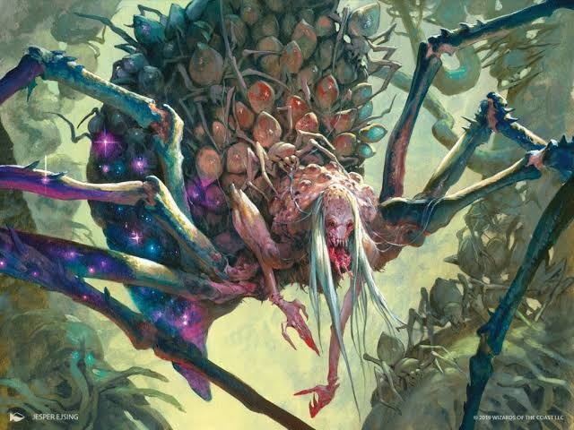

  
Mael'ra

  

    
    
Mael'ra, a Deusa-Fera Aranha

  

  <table>
    <tr><td><b>Tipo</b></td><td>[[Deuses-Fera/Deus-Fera|Deus-Fera]]</td></tr>
    <tr><td><b>Forma</b></td><td>Aranha gigantesca de seda prateada</td></tr>
    <tr><td><b>Domínio</b></td><td>Destino, Fio-Eterno, dívidas e suturas</td></tr>
    <tr><td><b>Habitat</b></td><td>Todo o [[Geografia/Vale da Lama|Vale da Lama]] (nômade)</td></tr>
    <tr><td><b>Adoradores</b></td><td>[[Tribos/Tece-Pele|Tece-Pele]]</td></tr>
    <tr><td><b>Símbolo</b></td><td>[[Tribos/Teia Prateada|Teia Prateada]]</td></tr>
  </table>

# Mael'ra (Deusa-Fera Aranha)

## Descrição

**Mael'ra**, a **Deusa-Fera Aranha**, é uma entidade espiritual de oito patas que transita entre o etéreo e o físico, representada como uma aranha gigantesca de seda prateada. É adorada pela tribo nômade [[Tribos/Tece-Pele|Tece-Pele]]. Ela tece o **Fio-Eterno**, uma teia metafórica que conecta todas as criaturas, ações e dívidas do [[Geografia/Vale da Lama|Vale da Lama]] — cada vida é um fio que pode ser tensionado, fortalecido ou cortado.

## O Fio-Eterno e a Natureza das Dívidas

Para os seguidores de Mael'ra, promessas, favores e trocas comerciais não são meras palavras — são fios físicos amarrados entre quem dá e quem recebe. Ao contrário do [[Cosmologia/Animismo|Animismo]] dos [[Tribos/Masca-Musgo|Masca-Musgo]] (que busca equilíbrio com o pântano vivo), o culto a Mael'ra enxerga o mundo como uma rede de obrigações exatas.

- **Sinais de Presença:** Quando uma dívida importante está prestes a ser cobrada, aranhas comuns do pântano passam a seguir silenciosamente o devedor, e fios soltos de seda prateada surgem amanhecidos sobre suas armas ou mochilas.

## Culto, Símbolos e Práticas

- **A Teia Prateada:** Seu símbolo máximo é a [[Tribos/Teia Prateada|Teia Prateada]], uma teia física de seda prateada que os [[Tribos/Tece-Pele|Tece-Pele]] erguem em seus acampamentos suspensos. Quem se emaranha nela é considerado marcado por Mael'ra.
- **Suturas em Carne Viva:** Em sua honra, os devotos praticam [[Tribos/Suturas em Carne Viva|suturas em carne viva]] com agulhas de osso fino e seda de aranha para fechar ferimentos em combate, selar uniões rituais ou implantar placas de pele e osso no próprio corpo.
- **Cobrança Implacável:** Nenhuma dívida é esquecida no Fio-Eterno. Devedores inadimplentes são marcados no rosto com tinta preta da teia e ficam sujeitos a cobrança em mercadoria ou em carne.

## Ganchos de Aventura

- Um fio prateado apareceu esticado entre duas raízes na entrada de [[Geografia/Raiz-Funda|Raiz-Funda]], indicando que um morador ou visitante deve algo aos [[Tribos/Tece-Pele|Tece-Pele]].
- Aranhas gigantes das [[Geografia/Copas da Teia Prateada|Copas da Teia Prateada]] estão tecendo ninhos muito mais baixos que o habitual, bloqueando um canal estreito usado por mercadores.

---

**Veja também:** [[Deuses-Fera/Deus-Fera|Deus-Fera]], [[Tribos/Tece-Pele|Tece-Pele]], [[Tribos/Teia Prateada|Teia Prateada]], [[Tribos/Suturas em Carne Viva|Suturas em Carne Viva]], [[Geografia/Copas da Teia Prateada|Copas da Teia Prateada]]
