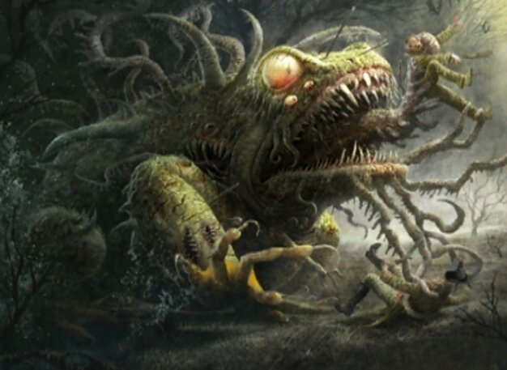

  
Og'gath

  

    
    
Og'gath, o Sapo-Trovão do Lago Central

  

  <table>
    <tr><td><b>Tipo</b></td><td><a href="../Deuses-Fera/Deus-Fera" class="internal">Deus-Fera</a></td></tr>
    <tr><td><b>Epíteto</b></td><td>Sapo-Trovão do Lago Central</td></tr>
    <tr><td><b>Espécie / Forma</b></td><td>Anfíbio colossal</td></tr>
    <tr><td><b>Gênero</b></td><td>Masculino</td></tr>
    <tr><td><b>Status</b></td><td>Vivo</td></tr>
    <tr><td><b>Local</b></td><td>Ilhotas e margens do <a href="../Geografia/Lago-da-Grande-Tirana" class="internal">Lago da Grande Tirana</a></td></tr>
    <tr><td><b>Perigo</b></td><td>Extremo</td></tr>
    <tr><td><b>Culto</b></td><td>Sem tribo devota conhecida</td></tr>
  </table>

# Og'gath (Sapo-Trovão do Lago Central)

<blockquote class="epigraph">*A preencher.*</blockquote>

**Og'gath**, o **Sapo-Trovão do Lago Central** para os moradores de [[Geografia/Raiz-Funda|Raiz-Funda]], domina as ilhotas do [[Geografia/Lago da Grande Tirana|Lago da Grande Tirana]], no coração do [[Geografia/Vale da Lama|Vale da Lama]]. Nenhuma tribo lhe ergue altares, mas seu coaxar grave atravessa o brejo e mantém canoas e batedores longe daquelas águas.

## Aparência
Um anfíbio colossal cuja massa pesada faz a lama e as margens das ilhotas centrais estremecerem a cada movimento.

## Personalidade e Maneirismos
Não sai à caça por capricho, mas não tolera intrusos: esmaga com fúria extrema qualquer criatura que se aproxime demais de seu território.

## História
*A preencher.*

## Função e Ocupação
Sem descanso, Og'gath patrulha as margens do [[Geografia/Lago da Grande Tirana|Lago da Grande Tirana]], como se procurasse algo perdido sob a água turva. Seu coaxar ecoa a quilômetros de distância e faz vibrar a terra e a superfície do lago central.

## Relações e Alianças
* **Povos do Vale:** Os goblins do vale evitam a qualquer custo suas ilhotas e as águas do lago central — já marcadas por embates entre feras espirituais e grandes predadores.

## O que se Conta pelo Pântano
- **A Busca sem Fim:** Ao redor das fogueiras de Raiz-Funda, ninguém sabe dizer o que o Sapo-Trovão procura nas margens do Lago da Grande Tirana — nem se essa vigília sem fim tem alguma relação com as profundezas onde jaz a carcaça de Cinderath.

---

**Veja também:** [[Deuses-Fera/Deus-Fera|Deus-Fera]] | [[Geografia/Lago da Grande Tirana|Lago da Grande Tirana]] | [[Geografia/Vale da Lama|Vale da Lama]]
