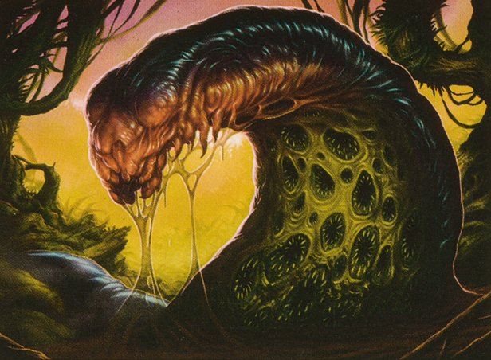

  
Sss'kar

  

    
    
Sss'kar

  

  <table>
    <tr><td><b>Tipo</b></td><td><a href="../Deuses-Fera/Deus-Fera" class="internal">Deus-Fera</a></td></tr>
    <tr><td><b>Epíteto</b></td><td>Sanguessuga das Águas Paradas</td></tr>
    <tr><td><b>Espécie / Forma</b></td><td>Sanguessuga colossal</td></tr>
    <tr><td><b>Gênero</b></td><td>*A preencher*</td></tr>
    <tr><td><b>Status</b></td><td>Vivo</td></tr>
    <tr><td><b>Domínio</b></td><td>Sangue, vitalidade e águas paradas</td></tr>
    <tr><td><b>Local</b></td><td><a href="../Geografia/Aguas-Paradas-Profundas" class="internal">Águas Paradas Profundas</a> (Sul)</td></tr>
    <tr><td><b>Adoradores</b></td><td><a href="../Tribos/Ventre-Inchado" class="internal">Ventre-Inchado</a></td></tr>
    <tr><td><b>Rumor</b></td><td>Rainha-Sanguessuga (Perigo Alto)</td></tr>
  </table>

# Sss'kar

<blockquote class="epigraph">*A preencher.*</blockquote>

**Sss'kar** é uma sanguessuga colossal — um [[Deuses-Fera/Deus-Fera|Deus-Fera]] que habita o sul abafado do [[Geografia/Vale da Lama|Vale da Lama]], onde a água estagnada apodrece sob o dossel fechado. Cultuado pela reclusa tribo [[Tribos/Ventre-Inchado|Ventre-Inchado]], representa a recusa da morte e a permanência da carne mantida pelo sangue.

## Aparência
Sanguessuga colossal de corpo moldado para deslizar na água morna, turva e estagnada das [[Geografia/Aguas Paradas Profundas|Águas Paradas Profundas]].

## Personalidade e Maneirismos
*A preencher.*

## História
*A preencher.*

## Função e Ocupação
Para os [[Tribos/Ventre-Inchado|Ventre-Inchado]], o sangue guarda a centelha da vida, e derramá-lo fortalece tanto o deus quanto o devoto. Em suas aldeias, criam [[Tribos/Sanguessugas Gigantes|sanguessugas gigantes]] em ânforas de barro e odres de couro úmido para sangrias rituais e oferendas.

Essa prática opõe o sul ao [[Cosmologia/Nyog'Sothep#O Ciclo da Devolução|Ciclo da Devolução]] pregado pelos [[Tribos/Masca-Musgo|Masca-Musgo]]. Entre os seguidores de Sss'kar, os devotos mais velhos — conhecidos pelo vale como *anciãos vampíricos* — bebem sangue em rituais secretos para estender a própria vida muito além de um século, recusando o retorno ao lodo.

## Relações e Alianças
* **[[Tribos/Ventre-Inchado|Ventre-Inchado]]:** Sua tribo devota no sul, conduzida em ritos antigos e sangrentos por anciãos como [[NPCs/Murok|Murok]].

## O que se Conta pelo Pântano
- **[[Criaturas/Rainha-Sanguessuga de Águas Paradas|Rainha-Sanguessuga de Águas Paradas]]** *(Lago da Grande Tirana / Sul — Perigo Alto)*: Caçadores da borda sul do [[Geografia/Lago da Grande Tirana|Lago da Grande Tirana]] dizem que uma sanguessuga do tamanho de uma barcaça anda cruzando os canais que ligam o lago aos [[Tribos/Ventre-Inchado|Ventre-Inchado]], sem que ninguém saiba se é cria de Sss'kar ou o próprio deus.

---

**Veja também:** [[Deuses-Fera/Deus-Fera|Deus-Fera]] | [[Tribos/Ventre-Inchado|Ventre-Inchado]] | [[Geografia/Aguas Paradas Profundas|Águas Paradas Profundas]] | [[NPCs/Murok|Murok]] | [[Cosmologia/Nyog'Sothep|Nyog'Sothep]]
