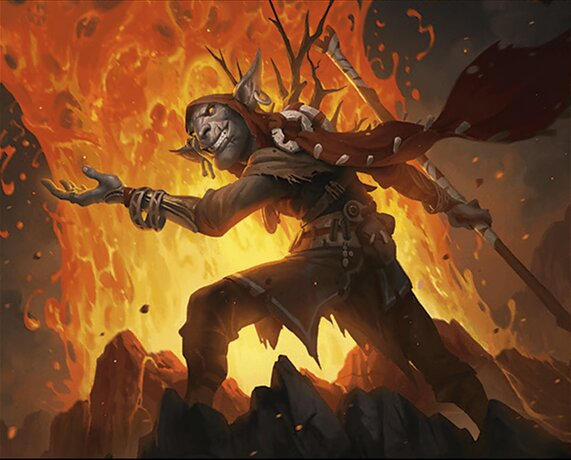

  
Brask

  

    
    
Brask

  

  <table>
    <tr><td><b>Tipo</b></td><td><a href="../Exilados/Exilados" class="internal">Exilado</a></td></tr>
    <tr><td><b>Epíteto</b></td><td>*A preencher*</td></tr>
    <tr><td><b>Espécie</b></td><td>Goblin</td></tr>
    <tr><td><b>Gênero</b></td><td>Masculino</td></tr>
    <tr><td><b>Status</b></td><td>Vivo</td></tr>
    <tr><td><b>Tribo</b></td><td>Exilado de <a href="../Geografia/Raiz-Funda" class="internal">Raiz-Funda</a> (<a href="../Tribos/Masca-Musgo" class="internal">Masca-Musgo</a>)</td></tr>
    <tr><td><b>Local</b></td><td>*A preencher*</td></tr>
    <tr><td><b>Devoção</b></td><td>*A preencher*</td></tr>
    <tr><td><b>Motivo do Exílio</b></td><td>*A preencher*</td></tr>
  </table>

# Brask

**Brask** é um antigo morador de [[Geografia/Raiz-Funda|Raiz-Funda]] que hoje sobrevive como [[Exilados/Exilados|exilado]] pelas margens do [[Geografia/Vale da Lama|Vale da Lama]]. Afastado dos [[Tribos/Masca-Musgo|Masca-Musgo]] por sentença de [[NPCs/Velho Rói-Raiz|Velho Rói-Raiz]], carrega o fardo de viver fora das passarelas e das habitações escavadas nos [[Geografia/Cogumelos Nodosos|Cogumelos Nodosos]], sem fogueira tribal para aquecer a noite nem direito às trilhas seguras da aldeia.

Como todo banido, Brask teve cortado não apenas o convívio com o clã, mas também o direito de repousar nos leitos úmidos do [[Geografia/Jardim Dourado|Jardim Dourado]] quando a morte vier cobrá-lo. Para ele, não existe retorno: aproximar-se dos limites vigiados de Raiz-Funda significa encarar o silêncio das arcadas de mangue e as flechas das sentinelas de [[NPCs/Varga|Varga]] — a primeira para avisar, a segunda para matar.

## Aparência
*A preencher.*

## Personalidade e Maneirismos
*A preencher.*

## História
*A preencher.*

## Função e Ocupação
*A preencher.*

## Relações e Alianças
*A preencher.*

## O que se Conta pelo Pântano
*A preencher.*

---

**Veja também:** [[Exilados/Exilados|Exilados]] | [[Geografia/Raiz-Funda|Raiz-Funda]] | [[NPCs/Velho Rói-Raiz|Velho Rói-Raiz]] | [[Geografia/Jardim Dourado|Jardim Dourado]]
