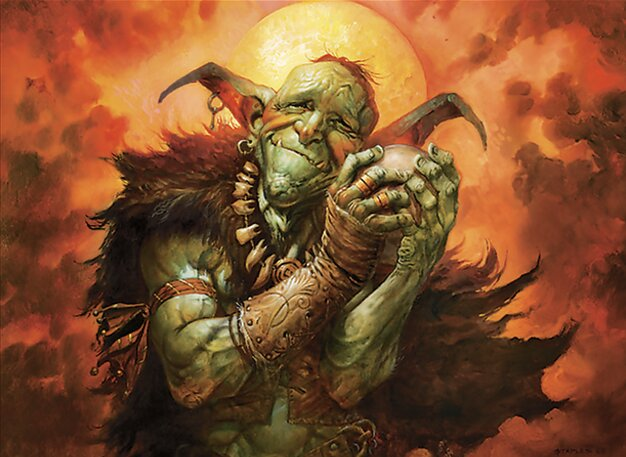

  
Nokk

  

    
    
Nokk

  

  <table>
    <tr><td><b>Tipo</b></td><td><a href="../Exilados/Exilados" class="internal">Exilado</a></td></tr>
    <tr><td><b>Epíteto</b></td><td>*A preencher*</td></tr>
    <tr><td><b>Espécie</b></td><td>Goblin</td></tr>
    <tr><td><b>Gênero</b></td><td>Masculino</td></tr>
    <tr><td><b>Status</b></td><td>Vivo</td></tr>
    <tr><td><b>Tribo</b></td><td>Exilado de <a href="../Geografia/Raiz-Funda" class="internal">Raiz-Funda</a> (<a href="../Tribos/Masca-Musgo" class="internal">Masca-Musgo</a>)</td></tr>
    <tr><td><b>Local</b></td><td>*A preencher*</td></tr>
    <tr><td><b>Devoção</b></td><td>*A preencher*</td></tr>
    <tr><td><b>Motivo do Exílio</b></td><td>*A preencher*</td></tr>
  </table>

# Nokk

**Nokk** é um antigo habitante de [[Geografia/Raiz-Funda|Raiz-Funda]] lançado fora da tribo [[Tribos/Masca-Musgo|Masca-Musgo]] para errar como [[Exilados/Exilados|exilado]] pelo [[Geografia/Vale da Lama|Vale da Lama]]. Longe da proteção das estivas de madeira e do abrigo dos [[Geografia/Cogumelos Nodosos|Cogumelos Nodosos]], sua sobrevivência se resume ao que consegue arrancar da lama fria e das bordas esquecidas do brejo, onde nenhuma aldeia oferece teto, troca justa ou abrigo contra a névoa de esporos.

Sobre ele pesa a mesma sentença irrevogável ditada por [[NPCs/Velho Rói-Raiz|Velho Rói-Raiz]] a todos os expulsos: a perda de lugar entre os vivos e da devolução aos leitos de turfa do [[Geografia/Jardim Dourado|Jardim Dourado]]. Caso ouse testar a vigilância de Raiz-Funda, encontrará apenas o aviso seco das flechas de [[NPCs/Varga|Varga]] antes do segundo passo.

## Aparência
*A preencher.*

## Personalidade e Maneirismos
*A preencher.*

## História
*A preencher.*

## Função e Ocupação
*A preencher.*

## Relações e Alianças
*A preencher.*

## O que se Conta pelo Pântano
*A preencher.*

---

**Veja também:** [[Exilados/Exilados|Exilados]] | [[Geografia/Raiz-Funda|Raiz-Funda]] | [[NPCs/Velho Rói-Raiz|Velho Rói-Raiz]] | [[Geografia/Jardim Dourado|Jardim Dourado]]
