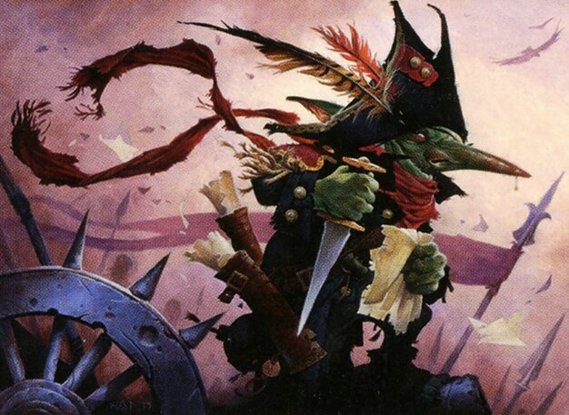

  
Skrit

  

    
    
Skrit

  

  <table>
    <tr><td><b>Tipo</b></td><td><a href="../Exilados/Exilados" class="internal">Exilado</a></td></tr>
    <tr><td><b>Epíteto</b></td><td>*A preencher*</td></tr>
    <tr><td><b>Espécie</b></td><td>Goblin</td></tr>
    <tr><td><b>Gênero</b></td><td>Masculino</td></tr>
    <tr><td><b>Status</b></td><td>Vivo</td></tr>
    <tr><td><b>Tribo</b></td><td>Exilado de <a href="../Geografia/Raiz-Funda" class="internal">Raiz-Funda</a> (<a href="../Tribos/Masca-Musgo" class="internal">Masca-Musgo</a>)</td></tr>
    <tr><td><b>Local</b></td><td>*A preencher*</td></tr>
    <tr><td><b>Devoção</b></td><td>*A preencher*</td></tr>
    <tr><td><b>Motivo do Exílio</b></td><td>*A preencher*</td></tr>
  </table>

# Skrit

**Skrit** é um antigo morador de [[Geografia/Raiz-Funda|Raiz-Funda]] que vive hoje como [[Exilados/Exilados|exilado]] pelo pântano.

## Aparência
*A preencher.*

## Personalidade e Maneirismos
*A preencher.*

## História
*A preencher.*

## Função e Ocupação
*A preencher.*

## Relações e Alianças
*A preencher.*

## O que se Conta pelo Pântano
*A preencher.*

---

**Veja também:** [[Exilados/Exilados|Exilados]] | [[Geografia/Raiz-Funda|Raiz-Funda]]
