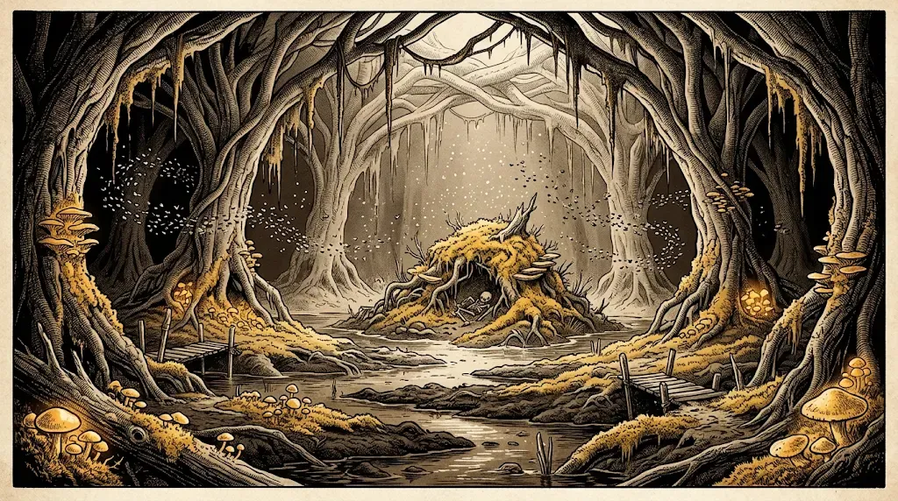

  
Jardim Dourado

  

    
    
O santuário sob as arcadas de mangue

  

  <table>
    <tr><td><b>Tipo</b></td><td>Santuário e necrópole sob arcadas de mangue</td></tr>
    <tr><td><b>Região</b></td><td>Coração de <a href="../Geografia/Raiz-Funda" class="internal">Raiz-Funda</a></td></tr>
    <tr><td><b>Status</b></td><td>Ativo (acesso restrito)</td></tr>
    <tr><td><b>Facção</b></td><td><a href="../Tribos/Masca-Musgo" class="internal">Masca-Musgo</a> (<a href="../NPCs/Irmãos-Snakk-e-Drig" class="internal">Snakk e Drig</a>)</td></tr>
    <tr><td><b>Devoção</b></td><td><a href="../Cosmologia/Nyog'Sothep" class="internal">Nyog'Sothep</a></td></tr>
    <tr><td><b>Perigo</b></td><td>Alto (esporos densos e guarda do clero)</td></tr>
  </table>

# O Jardim Dourado

Situado no coração de [[Geografia/Raiz-Funda|Raiz-Funda]], o **Jardim Dourado** é o santuário mais sagrado de [[Cosmologia/Nyog'Sothep|Nyog'Sothep]], onde repousa o [[Cosmologia/Idolo de Nyog'Sothep|Ídolo de Nyog'Sothep]] e onde são conduzidos os rituais fúnebres dos [[Tribos/Masca-Musgo|Masca-Musgo]].

## Geografia e Ambiente
É uma clareira abobadada formada por troncos e raízes colossais de mangue entrelaçadas em arcos naturais. Uma névoa úmida e uma luz difusa filtram-se do alto por entre as copas, misturando-se à bioluminescência âmbar das colônias de cogumelos e do [[Cosmologia/Micelio Dourado|Micélio Dourado]] que revestem o monte central de raízes e as margens de águas rasas ligadas por pequenas pontes de madeira. O ar é quente, espesso e doce como fruta passada, cortado pelo zumbido constante de pequenos enxames de moscas.

## História
*A preencher.*

## Sociedade e Pontos de Interesse
- **Relíquia Central:** É aqui que repousa hoje o **[[Cosmologia/Idolo de Nyog'Sothep|Ídolo de Nyog'Sothep]]**, protegido por uma ordem própria de guardas subordinada ao alto clero e acessível apenas a seus membros.
- **Ciclo da Devolução:** É aqui que os [[NPCs/Irmãos Snakk e Drig|Irmãos Snakk e Drig]] conduzem os corpos dos falecidos pelos três estágios do [[Cosmologia/Nyog'Sothep#O Ciclo da Devolução|Ciclo da Devolução]] e cultivam o [[Cosmologia/Micelio Dourado|Micélio Dourado]] mais potente do vale.
- **Acesso Restrito:** Apenas o [[NPCs/Sacerdote-Chefe Malok|Sacerdote-Chefe Malok]], os coveiros [[NPCs/Irmãos Snakk e Drig|Snakk e Drig]], a decana [[NPCs/Vó Mofo-Velho|Vó Mofo-Velho]] e curandeiros autorizados (como [[NPCs/Snikk|Snikk]]) podem entrar no círculo interno.

## Perigos e Recursos
- **Recurso Sagrado:** Principal fonte de [[Cosmologia/Micelio Dourado|Micélio Dourado]] puro do vale.
- **Perigo aos Forasteiros:** Quem se aproxima sem [[Cosmologia/Mascara de Ervas Amargas|máscara de ervas amargas]] sente tonturas e náuseas devido à densidade dos esporos. Profanar o Jardim Dourado é um anátema absoluto para os devotos de [[Cosmologia/Nyog'Sothep|Nyog'Sothep]].

## O que se Conta pelo Pântano
*A preencher.*

---

**Veja também:** [[Cosmologia/Nyog'Sothep|Nyog'Sothep]] | [[Cosmologia/Micelio Dourado|Micélio Dourado]] | [[Geografia/Raiz-Funda|Raiz-Funda]] | [[NPCs/Irmãos Snakk e Drig|Irmãos Snakk e Drig]]
