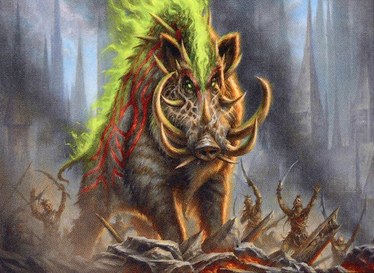

  
Poços de Turfa e Brejo do Musgo-Negro

  

    
    
Javali de Musgo-Negro

  

  <table>
    <tr><td><b>Tipo</b></td><td>Planície ocre-acinzentada e poços de piche</td></tr>
    <tr><td><b>Localização</b></td><td>Oeste, no sopé das [[Geografia/Montanhas do Oeste|Montanhas do Oeste]]</td></tr>
    <tr><td><b>Recursos</b></td><td>Piche natural (calafetar jangadas)</td></tr>
    <tr><td><b>Perigo</b></td><td>Atolamento, gases inflamáveis e musgo ácido</td></tr>
  </table>

# Os Poços de Turfa e o Brejo do Musgo-Negro

## Descrição

Os **Poços de Turfa e o Brejo do Musgo-Negro** formam uma zona de transição seca-lodosa no extremo oeste do [[Geografia/Vale da Lama|Vale da Lama]], encostada diretamente no sopé árido das [[Geografia/Montanhas do Oeste|Montanhas do Oeste]]. Onde o escoamento das montanhas encontra o pântano, a planície ocre-acinzentada torna-se instável e perfurada por manchas negras borbulhantes: poços profundos de piche e turfa espessa que liberam gases inflamáveis, cercados por crostas de musgo-negro ácido e cogumelos corrosivos.

## Uso na Mesa e Ganchos

- **Fronteira Natural:** Barreira perigosa entre [[Geografia/Raiz-Funda|Raiz-Funda]] e as terras secas do Extremo Oeste.
- **Extração de Piche:** O piche dos poços é um recurso valioso, usado pelos construtores como [[NPCs/Elenco de Raiz-Funda|Torg]] para calafetar jangadas e impermeabilizar madeira.
- **Riscos e Caçadas:** Risco extremo de atolamento, bolsões de gases tóxicos/inflamáveis (muito perigosos perto de qualquer faísca) e território de caça às feras mais resistentes do vale, como o [[Criaturas/Javali de Musgo-Negro|Javali de Musgo-Negro]].

---

**Veja também:** [[Geografia/Vale da Lama|Vale da Lama]], [[Geografia/Montanhas do Oeste|Montanhas do Oeste]], [[Geografia/Raiz-Funda|Raiz-Funda]], [[Cosmologia/Codigo de Honra do Fogo|Código de Honra do Fogo]]
