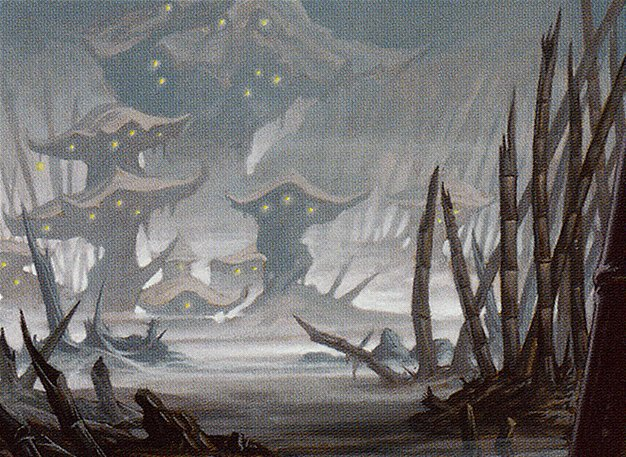

  
Raiz-Funda

  

    
    
Raiz-Funda sob a névoa do pântano

  

  <table>
    <tr><td><b>Tipo</b></td><td>Aldeia em Cogumelos Nodosos e palafitas</td></tr>
    <tr><td><b>Região</b></td><td>Setor Oeste do <a href="../Geografia/Vale-da-Lama" class="internal">Vale da Lama</a></td></tr>
    <tr><td><b>Status</b></td><td>Ativo</td></tr>
    <tr><td><b>Facção</b></td><td><a href="../Tribos/Masca-Musgo" class="internal">Masca-Musgo</a></td></tr>
    <tr><td><b>Devoção</b></td><td><a href="../Cosmologia/Nyog'Sothep" class="internal">Nyog'Sothep</a></td></tr>
    <tr><td><b>Perigo</b></td><td>Médio para forasteiros (trilhas ocultas e armadilhas)</td></tr>
  </table>

# Raiz-Funda

<blockquote class="epigraph">*A preencher.*</blockquote>

**Raiz-Funda** é o coração vivo dos [[Tribos/Masca-Musgo|Masca-Musgo]], erguida no setor oeste do [[Geografia/Vale da Lama|Vale da Lama]]. Escondida sob o dossel úmido de um mangue ancestral e ancorada em imensos **Cogumelos Nodosos**, a aldeia não foi construída contra o pântano, mas dentro dele: suas moradias são escavadas no interior dos próprios cogumelos gigantes e ligadas por palafitas, passarelas estreitas e pontes de corda suspensas sobre canais de lama profunda. Para um forasteiro, chegar até suas passarelas sem guia já é uma provação; sair delas sem permissão é quase impossível.

## Geografia e Ambiente
Quem se aproxima de Raiz-Funda pela neblina baixa do oeste primeiro ouve a aldeia antes de enxergá-la: o bater ritmado de madeira contra madeira nas oficinas do cais, o tilintar distante de ossos e conchas, e assobios curtos vindos do alto das arcadas que imitam aves e anfíbios do brejo.

Os **Cogumelos Nodosos** formam o esqueleto da aldeia. Seus caules espessos e chapéus largos abrigam câmaras escavadas que protegem os moradores da chuva ácida e do sol, enquanto as **palafitas** de madeira de mangue impermeabilizada com resina avançam sobre os canais escuros. Cada bairro tem um cheiro próprio: perto do cais, o ar é ácido e pungente pelos taninos de curtume e tonéis de fermentação; no centro, sob as raízes mais fundas, sobe um perfume quente e adocicado de esporos vindo do [[Geografia/Jardim Dourado|Jardim Dourado]]; já na borda externa, onde fica a ilhota da forja, sente-se o único fio constante de fumaça da aldeia, mantido longe das casas e das raízes vivas.

## História
Raiz-Funda nasceu logo após o fim da [[Historia/A Grande Morte Lenta|Grande Morte Lenta]] e da **[[Historia/Cacada Sagrada|Primeira Caçada Sagrada]]**. Quando os goblins abandonaram as minas das [[Geografia/Montanhas do Oeste|Montanhas do Oeste]] após derrubarem o [[Tribos/Povo Dragão|Povo Dragão]], trouxeram consigo o [[Cosmologia/Idolo de Nyog'Sothep|Ídolo de Nyog'Sothep]] e buscaram no leste um lugar onde o próprio terreno impedisse qualquer novo tirano de acorrentá-los. Ao consagrarem a clareira central sob o mangue ancestral ao seu Deus, ergueram as primeiras escavações nos Cogumelos Nodosos e selaram o [[Cosmologia/Codigo de Honra do Fogo|Código de Honra do Fogo]] — jurando nunca mais usar as chamas como arma de punição ou domínio.

## Sociedade e Pontos de Interesse
A vida cotidiana em Raiz-Funda gira inteiramente em torno do **escambo**, da [[Tribos/Preparacao a Frio|Preparação a Frio]] e do respeito à [[Cosmologia/Lei da Troca|Lei da Troca]]. Mesmo dentro da aldeia, há espaços públicos de trabalho e parlamentação e zonas sagradas cujo acesso é severamente controlado.

### Pontos de Interesse

#### A Casa do Ancião
Uma estrutura ampla entrelaçada entre três raízes-mestras no nível intermediário da aldeia. É onde residem [[NPCs/Vó Mofo-Velho|Vó Mofo-Velho]], guardiã da memória oral da tribo, e [[NPCs/Velho Rói-Raiz|Velho Rói-Raiz]], o Juiz das Disputas. Visitantes de fora são conduzidos até aqui para parlamentar sob vigilância, e é diante da aldeia reunida neste espaço que Rói-Raiz julga quebras da [[Cosmologia/Lei da Troca|Lei da Troca]], aplica a **[[Cosmologia/Sentenca do Esquecimento|Marca de Cinza Fria]]** ou pronuncia a temida **Sentença do Esquecimento** e o exílio.

#### O Jardim Dourado
No centro mais profundo e abobadado de Raiz-Funda fica o **[[Geografia/Jardim Dourado|Jardim Dourado]]**, santuário e necrópole máxima de [[Cosmologia/Nyog'Sothep|Nyog'Sothep]]. Iluminado pela bioluminescência âmbar do [[Cosmologia/Micelio Dourado|Micélio Dourado]], abriga os leitos do *Ciclo da Devolução* conduzidos pelos [[NPCs/Irmãos Snakk e Drig|Irmãos Snakk e Drig]] e guarda o [[Cosmologia/Idolo de Nyog'Sothep|Ídolo de Nyog'Sothep]]. O círculo interno é vigiado pelos **[[Tribos/Jardineiros|Jardineiros]]** — uma ordem própria subordinada ao alto clero — e interditado a quase todos os moradores.

#### O Cais das Jangadas e Oficinas
Na faixa onde os canais se abrem para as rotas do pântano, [[NPCs/Torg|Torg]] constrói e repara jangadas de fundo chato e fabrica calçados largos de brejo para atravessar a lama profunda, usando piche natural trazido dos [[Geografia/Pocos de Turfa e Brejo do Musgo-Negro|Poços de Turfa]]. Logo ao lado ficam os tonéis de fermentação e o curtume de [[NPCs/Birka|Birka (a Mão-Ácida)]], que trabalha inteiramente a frio para produzir antídotos, peles curtidas e as [[Cosmologia/Mascara de Ervas Amargas|Máscaras de Ervas Amargas]] — além de ser a principal ponte de escambo com os nômades [[Tribos/Tece-Pele|Tece-Pele]].

#### A Forja Periférica de Gnarl
Isolada em uma ilhota de pedra e barro batido na borda externa de Raiz-Funda e cercada por canais de água, a oficina de [[NPCs/Gnarl Martelo-Torto|Gnarl Martelo-Torto]] é o único lugar onde o fogo arde com regularidade — sempre baixo e contido como **fogo-ferramenta**, conforme exige o [[Cosmologia/Codigo de Honra do Fogo|Código de Honra do Fogo]]. Como não há mineração ativa no vale, Gnarl reaproveita sucatas e ferragens recuperadas de fora ou das [[Geografia/Ruinas dos Sem-Nome|Ruínas dos Sem-Nome]], enquanto fabrica a frio o equipamento cotidiano de madeira de mangue e osso curado.

### Moradores e Líderes

| Personagem | Função / Cargo | Área |
|------------|----------------|------|
| [[NPCs/Sacerdote-Chefe Malok\|Sacerdote-Chefe Malok]] | Líder espiritual e político máximo | Clero |
| [[NPCs/Zog\|Zog (Voz-de-Esporo)]] | Xamã animista e conselheiro da [[Cosmologia/Lei da Troca\|Lei da Troca]] | Clero |
| [[NPCs/Irmãos Snakk e Drig\|Irmãos Snakk e Drig]] | Coveiros-Sacerdotes do [[Geografia/Jardim Dourado\|Jardim Dourado]] | Clero |
| [[NPCs/Kruk\|Kruk]] | Mestre dos Caçadores | Caça |
| [[NPCs/Grixa\|Grixa]] | Batedora de Elite (rival de Kruk) | Caça |
| [[NPCs/Gnarl Martelo-Torto\|Gnarl Martelo-Torto]] | Ferreiro e armeiro da Forja Periférica | Artesanato |
| [[NPCs/Birka\|Birka (a Mão-Ácida)]] | Alquimista e curtidora | Artesanato |
| [[NPCs/Torg\|Torg]] | Construtor de palafitas, jangadas e calçados | Artesanato |
| [[NPCs/Varga\|Varga]] | Capitã da Guarda | Defesa |
| [[NPCs/Vó Mofo-Velho\|Vó Mofo-Velho]] | Decana e guardiã da memória oral | Anciãos |
| [[NPCs/Velho Rói-Raiz\|Velho Rói-Raiz]] | Juiz das Disputas | Anciãos |
| [[NPCs/Snikk\|Snikk]] | Curandeiro-Chefe | Cura |

## Perigos e Recursos
- **Lama Traiçoeira:** Ao redor da aldeia, o brejo não oferece apoio firme; quem desconhece as trilhas submersas marcadas por estacas de osso afunda rapidamente.
- **Vigias nas Raízes:** Batedores e sentinelas sob o comando de [[NPCs/Varga|Varga]] vigiam as abordagens do alto das arcadas superiores, comunicando-se por assobios que imitam a fauna do pântano.
- **Armadilhas de Brejo:** Redes de cipó trançado e estacas de osso ocultas sob a lâmina d'água protegem as entradas periféricas.
- **Tolerância Zero com Exilados:** Qualquer um dos [[Exilados/Exilados|Exilados]] que tente se reaproximar de Raiz-Funda é recebido com flechas de aviso das sentinelas — e morto caso insista em avançar.

## O que se Conta pelo Pântano
- **Duas Guardas, Dois Deveres:** Comenta-se que a autoridade de [[NPCs/Varga|Varga]] termina exatamente onde começam as pontes do [[Geografia/Jardim Dourado|Jardim Dourado]], domínio exclusivo dos [[Tribos/Jardineiros|Jardineiros]] e do alto clero.
- **A Disputa das Caçadas:** Nas passarelas perto do cais, caçadores dividem-se entre a cautela tradicional de [[NPCs/Kruk|Kruk]] e a ousadia de [[NPCs/Grixa|Grixa]] diante das ameaças nas fronteiras do vale.
- **Visitantes de Seda Prateada:** De tempos em tempos, mensageiros [[Tribos/Tece-Pele|Tece-Pele]] aparecem nos limites do cais para negociar em escambo com [[NPCs/Birka|Birka]], trazendo rumores de todo o vale em troca de peles e reagentes.

---

**Veja também:** [[Cosmologia/Nyog'Sothep|Nyog'Sothep]] | [[Cosmologia/Micelio Dourado|Micélio Dourado]] | [[Cosmologia/Codigo de Honra do Fogo|Código de Honra do Fogo]] | [[Tribos/Masca-Musgo|Masca-Musgo]] | [[Geografia/Jardim Dourado|Jardim Dourado]] | [[Tribos/Jardineiros|Os Jardineiros]] | [[Exilados/Exilados|Exilados]] | [[Geografia/Vale da Lama|Vale da Lama]]
