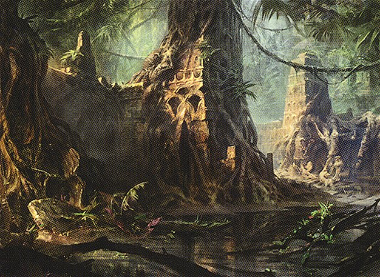

  
Ruínas dos Sem-Nome

  

    
    
As Pedras Mortas tomadas pelas raízes

  

  <table>
    <tr><td><b>Tipo</b></td><td>Ruínas antigas semi-submersas</td></tr>
    <tr><td><b>Região</b></td><td>Península norte-central e margens leste do <a href="../Geografia/Lago-da-Grande-Tirana" class="internal">lago central</a></td></tr>
    <tr><td><b>Status</b></td><td>Abandonado (evitado pelos goblins)</td></tr>
    <tr><td><b>Facção</b></td><td>Nenhuma (evitada pelos <a href="../Tribos/Masca-Musgo" class="internal">Masca-Musgo</a>)</td></tr>
    <tr><td><b>Devoção</b></td><td>Desconhecida (civilização élfica extinta)</td></tr>
    <tr><td><b>Perigo</b></td><td>Alto (masmorra semi-submersa)</td></tr>
  </table>

# As Ruínas dos Sem-Nome

<blockquote class="epigraph">*A preencher.*</blockquote>

As **Ruínas dos Sem-Nome** — chamadas pelos goblins de **As Pedras Mortas** — ocupam a península norte-central e as margens leste do [[Geografia/Lago da Grande Tirana|Lago da Grande Tirana]]. Erguidas muito antes dos dragões e dos próprios goblins, formam um enclave de pedra fria no meio do [[Geografia/Vale da Lama|Vale da Lama]] onde a vegetação do brejo pouco vinga.

## Geografia e Ambiente
Colunas estriadas partidas, arcos ogivais de mármore branco-acinzentado e torres arruinadas inclinam-se sobre a lama e a água rasa. O ar é frio e tem cheiro mineral de pedra molhada, sem o odor de esporos ou fermentação do restante do vale. Musgo e fungos crescem ralos e escassos sobre o mármore liso.

## História
Uma **civilização élfica extinta** ergueu essas estruturas eras antes da chegada dos dragões ao vale, na mesma época das ruínas das [[Geografia/Terras Verdejantes|Terras Verdejantes]]. Os goblins desconhecem quem foram seus construtores, que deuses cultuavam ou o que causou sua queda.

## Sociedade e Pontos de Interesse

### Pontos de Interesse
- **Pavilhões Semi-Submersos:** Átrios abertos onde raízes grossas envolvem arcos ogivais partidos sobre a lâmina d'água.
- **Câmaras Seladas:** Salões inferiores vedados contra a umidade do brejo, com ar parado há séculos.
- **Inscrições Indecifráveis:** Frisos desgastados pela chuva em um alfabeto antigo que ninguém no vale lê.

### NPCs e Criaturas da Região
Nenhuma tribo monta acampamento ou finca palafitas aqui. Para os [[Tribos/Masca-Musgo|Masca-Musgo]], o mármore é terra estéril e amaldiçoada, onde o ciclo de [[Cosmologia/Nyog'Sothep|Nyog'Sothep]] não se sustenta.

## Perigos e Recursos
- **Estrutura Instável:** Lajes rachadas e arcos antigos ameaçam ceder sob peso, e os acessos subterrâneos permanecem inexplorados pelas tribos.
- **Ferragens Antigas:** Peças metálicas arrancadas dos pórticos são ocasionalmente aproveitadas por artesãos como [[NPCs/Gnarl Martelo-Torto|Gnarl Martelo-Torto]], quando algum batedor se arrisca a buscá-las.

## O que se Conta pelo Pântano
- **Criaturas de Fogo e Fumaça:** Nenhuma jangada atraca nas Pedras Mortas depois do pôr do sol. Corre entre as tribos que **criaturas de fogo e fumaça** patrulham os túneis sob o mármore e ninguém que desceu até lá voltou.

---

**Veja também:** [[Geografia/Vale da Lama|Vale da Lama]] | [[Geografia/Lago da Grande Tirana|Lago da Grande Tirana]] | [[Geografia/Terras Verdejantes|Terras Verdejantes]] | [[Geografia/Delta das Aguas Mortas|Delta das Águas Mortas]] | [[Historia/A Grande Morte Lenta|A Grande Morte Lenta]]
