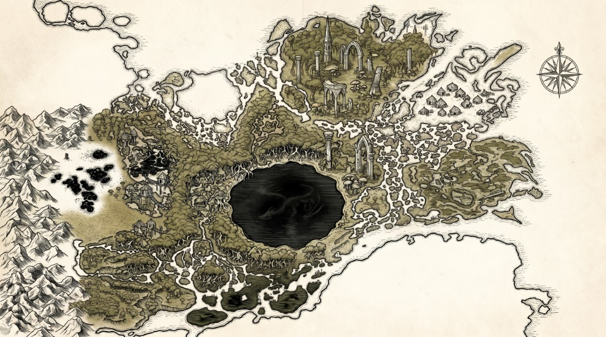

  
Vale da Lama

  

    
    
Mapa do Vale da Lama

  

  <table>
    <tr><td><b>Tipo</b></td><td>Bacia pantanosa extensa</td></tr>
    <tr><td><b>Região</b></td><td>Leste das <a href="../Geografia/Montanhas-do-Oeste" class="internal">Montanhas do Oeste</a></td></tr>
    <tr><td><b>Status</b></td><td>Ativo (múltiplas tribos)</td></tr>
    <tr><td><b>Facção</b></td><td><a href="../Tribos/Masca-Musgo" class="internal">Masca-Musgo</a>, <a href="../Tribos/Ferve-Alga-(Olhos-Vermelhos)" class="internal">Ferve-Alga</a>, <a href="../Tribos/Ventre-Inchado" class="internal">Ventre-Inchado</a>, <a href="../Tribos/Tece-Pele" class="internal">Tece-Pele</a></td></tr>
    <tr><td><b>Devoção</b></td><td><a href="../Cosmologia/Nyog'Sothep" class="internal">Nyog'Sothep</a> e <a href="../Deuses-Fera/Deus-Fera" class="internal">Deuses-Fera</a></td></tr>
    <tr><td><b>Perigo</b></td><td>Alto a Extremo</td></tr>
  </table>

# Vale da Lama

<blockquote class="epigraph">"Tudo o que entra no pântano exige troca; tudo o que cai na lama retorna ao ciclo."</blockquote>

O **Vale da Lama** é uma depressão pantanosa extensa a leste das [[Geografia/Montanhas do Oeste|Montanhas do Oeste]] e aberta a nordeste para o **[[Geografia/Mar das Brumas|Mar das Brumas]]**. Cercado por escarpas baixas de rocha erodida que retêm as águas e a neblina espessa durante quase todo o ano, é um mundo sem estradas: quem cruza seus canais depende de ler a maré, o lodo e os limites invisíveis entre tribos e entidades espirituais.

## Geografia e Ambiente
Não há campos abertos nem caminhos firmes contínuos. O vale se divide em canais lodosos, ilhotas de turfa instável, mangues de raízes altas e bosques de cogumelos gigantes cujos chapéus filtram a luz do sol. As águas que descem das [[Geografia/Montanhas do Oeste|Montanhas do Oeste]] atravessam o brejo até convergir no [[Geografia/Lago da Grande Tirana|Lago da Grande Tirana]], antes de escoarem para o mar.

![[assets/mapa-vale-da-lama.jpg]]

| Região | Direção | Quem Domina | Nível de Perigo |
|--------|---------|-------------|-----------------|
| [[Geografia/Lago da Grande Tirana\|Lago da Grande Tirana]] | Centro | Disputado / Evitado ([[Deuses-Fera/Og'gath\|Og'gath]]) | Alto a Extremo |
| [[Geografia/Raiz-Funda\|Raiz-Funda]] | Oeste | [[Tribos/Masca-Musgo\|Masca-Musgo]] | Médio para forasteiros |
| [[Geografia/Pocos de Turfa e Brejo do Musgo-Negro\|Poços de Turfa e Brejo do Musgo-Negro]] | Oeste (Sopé) | [[Deuses-Fera/Suuhr\|Suuhr]] | Alto |
| [[Geografia/Copas da Teia Prateada\|Copas da Teia Prateada]] | Noroeste | [[Tribos/Tece-Pele\|Tece-Pele]] | Médio a Alto |
| [[Geografia/Ruinas dos Sem-Nome\|Ruínas dos Sem-Nome]] | Norte-Central e Leste | Nenhuma tribo (evitado) | Alto |
| [[Geografia/Costa Salobra\|Costa Salobra e Os Caldeirões]] | Nordeste | [[Tribos/Ferve-Alga (Olhos-Vermelhos)\|Ferve-Alga]] ([[Deuses-Fera/Karkinos\|Karkinos]]) | Alto |
| [[Geografia/Aguas Paradas Profundas\|Águas Paradas Profundas]] | Sul | [[Tribos/Ventre-Inchado\|Ventre-Inchado]] ([[Deuses-Fera/Sss'kar\|Sss'kar]]) | Alto |
| [[Geografia/Delta das Aguas Mortas\|Delta das Águas Mortas]] | Leste / Sudeste | Nenhuma tribo | Alto |
| [[Geografia/Terras Verdejantes\|Terras Verdejantes]] | Além das Ruínas (fora do vale) | [[Criaturas/Ulok\|Ulok, a Grande Javali]] | Alto |

## História
Eras antes dos goblins, uma civilização élfica extinta ergueu os pórticos de mármore hoje conhecidos como [[Geografia/Ruinas dos Sem-Nome|Ruínas dos Sem-Nome]]. Séculos atrás, após a **[[Historia/A Grande Morte Lenta|Grande Morte Lenta]]** e a **[[Historia/Cacada Sagrada|Primeira Caçada Sagrada]]**, os goblins libertos das minas do oeste caçaram e exterminaram os [[Tribos/Povo Dragão|Dragões Vermelhos]] em fuga pelo vale — culminando na queda da Matriarca **Cinderath** nas profundezas do lago central. A decomposição secular desses corpos tornou as águas ácidas e turvas, abriu bolsões de gás sob a lama e adubou o solo para o [[Cosmologia/Micelio Dourado|Micélio Dourado]].

## Sociedade e Pontos de Interesse
1. **Centro — [[Geografia/Lago da Grande Tirana|O Lago da Grande Tirana]]:** Bacia circular funda e oleosa, evitada pelas tribos por servir de arena a feras espirituais e domínio a [[Deuses-Fera/Og'gath|Og'gath]].
2. **Oeste — [[Geografia/Raiz-Funda|Raiz-Funda]]:** Aldeia dos [[Tribos/Masca-Musgo|Masca-Musgo]], feita de moradias escavadas nos imensos Cogumelos Nodosos e de palafitas sobre canais escuros.
3. **Oeste (Sopé) — [[Geografia/Pocos de Turfa e Brejo do Musgo-Negro|Os Poços de Turfa e o Brejo do Musgo-Negro]]:** Planície ocre-acinzentada de betume borbulhante e musgo corrosivo, lar de [[Deuses-Fera/Suuhr|Suuhr]].
4. **Noroeste — [[Geografia/Copas da Teia Prateada|As Copas da Teia Prateada]]:** Manguezais altos de dossel contínuo onde os nômades [[Tribos/Tece-Pele|Tece-Pele]] estendem acampamentos suspensos.
5. **Norte-Central e Leste — [[Geografia/Ruinas dos Sem-Nome|As Ruínas dos Sem-Nome]]:** Colunas partidas e arcos ogivais de mármore pálido, temidos e evitados pelos goblins.
6. **Nordeste — [[Geografia/Costa Salobra|A Costa Salobra e Os Caldeirões]]:** Ilhotas de lama e crostas de salitre onde os [[Tribos/Ferve-Alga (Olhos-Vermelhos)|Ferve-Alga]] fervem salmoura perto das áreas de desova de [[Deuses-Fera/Karkinos|Karkinos]].
7. **Sul — [[Geografia/Aguas Paradas Profundas|As Águas Paradas Profundas]]:** Brejos abafados e sem correnteza controlados pelos reclusos [[Tribos/Ventre-Inchado|Ventre-Inchado]].
8. **Leste / Sudeste — [[Geografia/Delta das Aguas Mortas|O Delta das Águas Mortas]]:** Emaranhado de ilhotas e canais de maré que escoa o [[Geografia/Rio Lodo-Negro|Rio Lodo-Negro]] para o [[Geografia/Mar das Brumas|Mar das Brumas]].

## Perigos e Recursos
- **Comércio e Fronteiras:** Toda troca entre os povos do vale acontece por **escambo**. O atrito mais frequente nasce das invasões de fronteira entre os [[Tribos/Masca-Musgo|Masca-Musgo]] e os [[Tribos/Ferve-Alga (Olhos-Vermelhos)|Ferve-Alga]], enquanto os [[Tribos/Ventre-Inchado|Ventre-Inchado]] se mantêm isolados ao sul.
- **Leis Espirituais:** A [[Cosmologia/Lei da Troca|Lei da Troca]] e o [[Cosmologia/Codigo de Honra do Fogo|Código de Honra do Fogo]] regem quem circula pelo setor oeste e arredores.

## O que se Conta pelo Pântano
- **O Sapo-Trovão do Lago:** Batedores dizem que o coaxar grave de [[Deuses-Fera/Og'gath|Og'gath]] faz tremer as raízes na borda do [[Geografia/Lago da Grande Tirana|Lago da Grande Tirana]], e que ele ronda as margens como quem procura algo perdido na lama.
- **A Espadachim entre Fronteiras:** Nas trilhas disputadas entre Masca-Musgo e Ferve-Alga, viajantes rezam para não cruzar o caminho de [[Deuses-Fera/Krr'tak|Krr'tak]]; seu humor brutal só poupa goblins por uma dívida antiga com [[Cosmologia/Nyog'Sothep|Nyog'Sothep]] — e nem sempre a dívida segura a lâmina.
- **A Fúria Além das Pedras Mortas:** Poucos goblins atravessaram as ruínas até as [[Geografia/Terras Verdejantes|Terras Verdejantes]], mas todos repetem que a mata limpa de lá pertence às investidas imprevisíveis de [[Criaturas/Ulok|Ulok, a Grande Javali]].

---

**Veja também:** [[Historia/A Grande Morte Lenta|A Grande Morte Lenta]] | [[Geografia/Raiz-Funda|Raiz-Funda]] | [[Geografia/Lago da Grande Tirana|Lago da Grande Tirana]] | [[Geografia/Costa Salobra|Costa Salobra]] | [[Geografia/Aguas Paradas Profundas|Águas Paradas Profundas]] | [[Geografia/Montanhas do Oeste|Montanhas do Oeste]]
