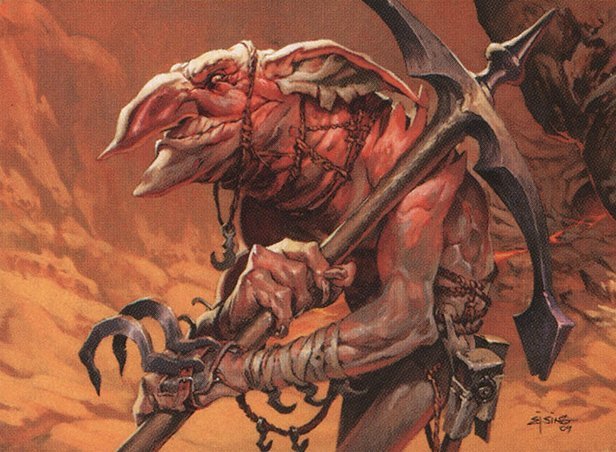

  
Gnarl Martelo-Torto

  

    
    
Gnarl Martelo-Torto

  

  <table>
    <tr><td><b>Tipo</b></td><td>NPC / Ferreiro e Armeiro</td></tr>
    <tr><td><b>Epíteto</b></td><td>Martelo-Torto</td></tr>
    <tr><td><b>Espécie</b></td><td>Goblin</td></tr>
    <tr><td><b>Gênero</b></td><td>Masculino</td></tr>
    <tr><td><b>Status</b></td><td>Vivo</td></tr>
    <tr><td><b>Tribo</b></td><td><a href="../Tribos/Masca-Musgo" class="internal">Masca-Musgo</a></td></tr>
    <tr><td><b>Local</b></td><td><a href="../Geografia/Raiz-Funda#a-forja-periférica-de-gnarl" class="internal">Forja Periférica de Raiz-Funda</a></td></tr>
    <tr><td><b>Devoção</b></td><td><a href="../Cosmologia/Nyog'Sothep" class="internal">Nyog'Sothep</a></td></tr>
  </table>

# Gnarl Martelo-Torto

<blockquote class="epigraph">*A preencher.*</blockquote>

**Gnarl Martelo-Torto** é o ferreiro e armeiro da [[Geografia/Raiz-Funda#A Forja Periférica de Gnarl|Forja Periférica de Raiz-Funda]]. Em uma aldeia construída dentro de Cogumelos Nodosos e sobre palafitas de madeira, Gnarl ocupa um posto singular e delicado: é o único morador que mantém uma forja acesa com regularidade, provando todos os dias que o fogo pode servir como ferramenta sem jamais voltar a ser arma de tirania.

## Aparência
*A preencher.*

## Personalidade e Maneirismos
É uma figura rabugenta, mas amplamente respeitada em [[Geografia/Raiz-Funda|Raiz-Funda]] pela disciplina rígida com que conduz sua forja.

## História
*A preencher.*

## Função e Ocupação
Gnarl trabalha em uma **ilhota de pedra e barro batido** na borda externa de [[Geografia/Raiz-Funda|Raiz-Funda]], cercada por canais d'água para garantir que nenhuma faísca alcance as raízes vivas ou a turfa seca. Sua atividade segue rigorosamente o [[Cosmologia/Codigo de Honra do Fogo|Código de Honra do Fogo]]: o fogo é mantido baixo e contido apenas como **fogo-ferramenta**, jamais usado para forjar armas incendiárias, punir ou causar dor.
- **Metal Recuperado:** Como não há mineração ativa no pântano, Gnarl reaproveita sucatas, ferragens antigas e peças vindas de fora do vale ou das [[Geografia/Ruinas dos Sem-Nome|Ruínas dos Sem-Nome]], endireitando lâminas tortas e reforçando ferramentas.
- **Trabalho a Frio:** Para o equipamento cotidiano da tribo — lanças de caça, anzóis, pontas e escudos —, trabalha madeira de mangue curada e osso tratado seguindo a [[Tribos/Preparacao a Frio|Preparação a Frio]].

## Relações e Alianças
* **[[NPCs/Kruk|Kruk]] e [[NPCs/Varga|Varga]]:** Fornece e repara as pontas de lança e lâminas usadas tanto pelas expedições de caça quanto pelas sentinelas das arcadas.

## O que se Conta pelo Pântano
- **O Fogo que Não Morde:** Entre os jovens que se preparam para a [[Historia/Cacada Sagrada|Caçada Sagrada]], diz-se que observar a brasa baixa de Gnarl cercada de água é a melhor lição sobre a diferença entre o fogo que molda a ferramenta e a chama profana dos antigos mestres.

---

**Veja também:** [[Geografia/Raiz-Funda|Raiz-Funda]] | [[Cosmologia/Codigo de Honra do Fogo|Código de Honra do Fogo]] | [[Tribos/Preparacao a Frio|Preparação a Frio]] | [[Geografia/Ruinas dos Sem-Nome|Ruínas dos Sem-Nome]]
