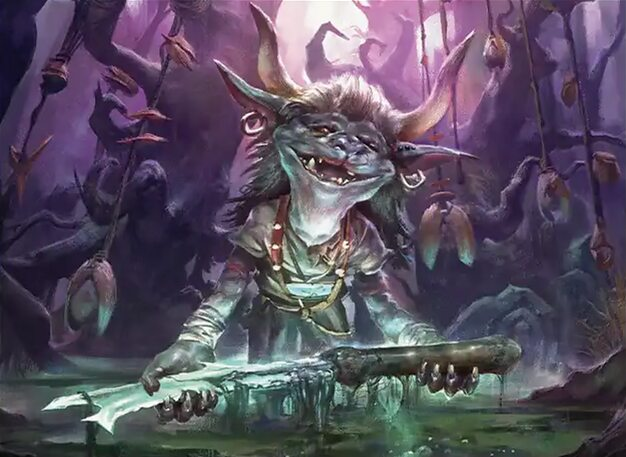

  
Grixa

  

    
    
Grixa, Batedora de Elite

  

  <table>
    <tr><td><b>Tipo</b></td><td>NPC / Batedora de Elite</td></tr>
    <tr><td><b>Epíteto</b></td><td>Batedora de Elite</td></tr>
    <tr><td><b>Espécie</b></td><td>Goblin</td></tr>
    <tr><td><b>Gênero</b></td><td>Feminino</td></tr>
    <tr><td><b>Status</b></td><td>Vivo</td></tr>
    <tr><td><b>Tribo</b></td><td><a href="../Tribos/Masca-Musgo" class="internal">Masca-Musgo</a></td></tr>
    <tr><td><b>Local</b></td><td><a href="../Geografia/Raiz-Funda" class="internal">Raiz-Funda</a></td></tr>
    <tr><td><b>Devoção</b></td><td><a href="../Cosmologia/Nyog'Sothep" class="internal">Nyog'Sothep</a></td></tr>
  </table>

# Grixa (Batedora de Elite)

<blockquote class="epigraph">*A preencher.*</blockquote>

**Grixa** é a **Batedora de Elite** de [[Geografia/Raiz-Funda|Raiz-Funda]], uma das caçadoras mais rápidas e temidas dos [[Tribos/Masca-Musgo|Masca-Musgo]]. Onde outros goblins avançam com cautela pelas rotas antigas, ela lê a inclinação dos juncos, o cheiro da maré e os sinais da neblina para se mover além das fronteiras seguras do oeste.

## Aparência
*A preencher.*

## Personalidade e Maneirismos
Rápida, silenciosa e extremamente observadora, Grixa raramente desperdiça movimentos ou palavras. Ao contrário dos veteranos mais conservadores da aldeia, defende **estratégias mais ousadas** diante das ameaças que rondam as fronteiras do [[Geografia/Vale da Lama|Vale da Lama]], acreditando que esperar passivamente atrás das arcadas de mangue apenas dá vantagem aos rivais e predadores.

## História
*A preencher.*

## Função e Ocupação
Atua como batedora avançada e guia experiente nas expedições de reconhecimento e na condução de [[Historia/Cacada Sagrada|Caçadas Sagradas]] fora de [[Geografia/Raiz-Funda|Raiz-Funda]]. Conhece bem passagens traiçoeiras até mesmo em regiões labirínticas como o [[Geografia/Delta das Aguas Mortas|Delta das Águas Mortas]], orientando-se por sinais sutis do terreno onde mapas comuns de nada valem.

## Relações e Alianças
* **[[NPCs/Kruk|Kruk]]:** Rivaliza diretamente com o Mestre dos Caçadores pela posição de liderança das expedições de caça. Enquanto Kruk se apega às rotas tradicionais e à prudência antiga, Grixa pressiona por incursões mais arrojadas e rápidas nas zonas disputadas do pântano.

## O que se Conta pelo Pântano
- **Os Passos que Não Afundam:** Caçadores mais jovens comentam que Grixa consegue cruzar canais estreitos e voltar ao cais de Raiz-Funda com notícias das fronteiras antes que o restante do grupo perceba sua ausência.
- **A Disputa pelo Cais:** Nos arredores do cais e das passarelas, a divisão entre os seguidores da cautela de [[NPCs/Kruk|Kruk]] e os partidários da ousadia de Grixa é um dos assuntos mais comentados entre os jovens que se preparam para a [[Historia/Cacada Sagrada|Caçada Sagrada]].

---

**Veja também:** [[Geografia/Raiz-Funda|Raiz-Funda]] | [[NPCs/Kruk|Kruk]] | [[Historia/Cacada Sagrada|A Caçada Sagrada]] | [[Tribos/Masca-Musgo|Masca-Musgo]] | [[Geografia/Delta das Aguas Mortas|Delta das Águas Mortas]]
