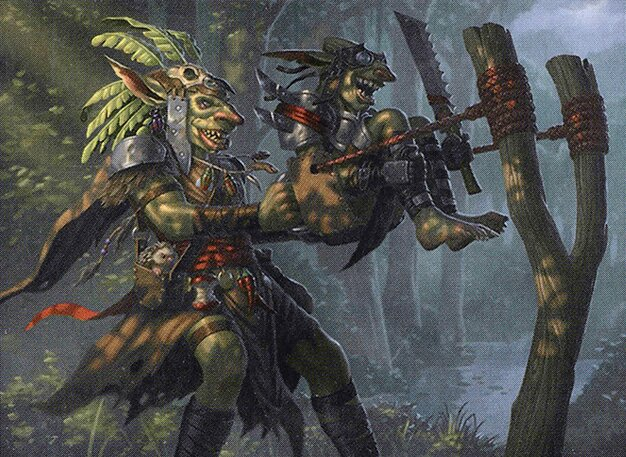

  
Irmãos Snakk e Drig

  

    
    
Irmãos Snakk e Drig

  

  <table>
    <tr><td><b>Tipo</b></td><td>NPCs / Coveiros-Sacerdotes e <a href="../Tribos/Jardineiros" class="internal">Jardineiros</a></td></tr>
    <tr><td><b>Epíteto</b></td><td>Coveiros-Sacerdotes</td></tr>
    <tr><td><b>Espécie</b></td><td>Goblins</td></tr>
    <tr><td><b>Gênero</b></td><td>Masculino</td></tr>
    <tr><td><b>Status</b></td><td>Vivos</td></tr>
    <tr><td><b>Tribo</b></td><td><a href="../Tribos/Masca-Musgo" class="internal">Masca-Musgo</a></td></tr>
    <tr><td><b>Local</b></td><td><a href="../Geografia/Jardim-Dourado" class="internal">Jardim Dourado</a> (<a href="../Geografia/Raiz-Funda" class="internal">Raiz-Funda</a>)</td></tr>
    <tr><td><b>Devoção</b></td><td><a href="../Cosmologia/Nyog'Sothep" class="internal">Nyog'Sothep</a></td></tr>
  </table>

# Irmãos Snakk e Drig

<blockquote class="epigraph">*A preencher.*</blockquote>

Os **Irmãos Snakk e Drig** são os **Coveiros-Sacerdotes** do [[Geografia/Jardim Dourado|Jardim Dourado]] e integrantes da ordem fechada dos **[[Tribos/Jardineiros|Jardineiros]]**, no coração de [[Geografia/Raiz-Funda|Raiz-Funda]]. Criados sob as arcadas úmidas da necrópole e longe da luz direta do sol, vivem imersos no cheiro doce de esporos e turfa revolvida.

Cabe a eles receber os mortos dos [[Tribos/Masca-Musgo|Masca-Musgo]], conduzir sua decomposição sagrada, colher o [[Cosmologia/Micelio Dourado|Micélio Dourado]] na medida exata da necessidade e guardar as pontes do círculo interno contra qualquer passo profano.

## Aparência
Snakk e Drig são gêmeos de pele pálida e olhos leitosos, desbotados por anos inteiros dentro da penumbra âmbar e da névoa espessa de esporos do santuário. Onde outros goblins trazem marcas de sol, vento ou salitre, os dois parecem moldados pela sombra úmida dos canteiros fúngicos.

## Personalidade e Maneirismos
Fora de seus ritos, Snakk e Drig demonstram pouca malícia: são meio burros, lentos para acompanhar argumentos retorcidos e inteiramente indiferentes às intrigas que fervem no cais. Não discutem política tribal nem disputam prestígio nas fogueiras.

Essa lentidão, porém, engana quem os subestima. Diante das ordens do alto clero, obedecem sem hesitar um instante; e, se algum intruso tenta violar os canteiros sagrados, a hesitação desaparece por completo — os dois revelam-se combatentes exímios, lutando com uma precisão brutal para defender o solo do santuário.

## História
*A preencher.*

## Função e Ocupação
Nos leitos de turfa do Jardim Dourado, os gêmeos conduzem cada cadáver pelos três estágios do [[Cosmologia/Ciclo da Devolucao|Ciclo da Devolução]]. Durante *O Inchaço* (dias 1 a 3), lavam o corpo com água de mangue e retiram metais e couros que ainda sirvam aos vivos; durante *A Floração* (dias 4 a 12), inclinam-se sobre a pele para ler os desenhos do bolor e honrar a memória do falecido; passado o 13º dia (*O Retorno*), recolhem os ossos limpos ou deixam que o restante afunde na lama fértil.

Além dos ritos fúnebres, zelam pelos canteiros bioluminescentes ao redor do monte central. Colhem o [[Cosmologia/Micelio Dourado|Micélio Dourado]] sob a medida severa da [[Cosmologia/Lei da Troca|Lei da Troca]], garantindo que nada seja arrancado por ganância ou desperdício.

## Relações e Alianças
* **[[NPCs/Sacerdote-Chefe Malok|Sacerdote-Chefe Malok]]:** Obedecem diretamente ao líder espiritual de Raiz-Funda, que supervisiona os ritos do santuário e determina quando o círculo interno deve se fechar.
* **[[Tribos/Jardineiros|Jardineiros]]:** Dividem a vigília silenciosa nas passagens do círculo interno, onde a guarda regular de [[NPCs/Varga|Varga]] não tem autoridade para entrar.
* **[[NPCs/Snikk|Snikk]]:** Entregam ao Curandeiro-Chefe as porções puras de [[Cosmologia/Micelio Dourado|Micélio Dourado]] usadas no tratamento de ferimentos graves — sabendo que a mesma mão que recebe o remédio às vezes devolve o corpo que não resistiu.

## O que se Conta pelo Pântano
* **Olhos que Leem o Bolor:** Quem nunca pisou além das pontes internas garante que Snakk e Drig conseguem narrar a vida inteira de um goblin apenas pela cor, pela espessura e pelo traçado das hifas que brotam sobre o peito durante *A Floração*.
* **Pás que Não Erram:** Nas fogueiras fora do santuário, caçadores mais ousados costumam rir da lentidão dos gêmeos para entender uma piada — mas nenhum deles tem coragem de testar o alcance dos dois perto dos canteiros dourados.

---

**Veja também:** [[Geografia/Raiz-Funda|Raiz-Funda]] | [[Geografia/Jardim Dourado|Jardim Dourado]] | [[Tribos/Jardineiros|Jardineiros]] | [[Cosmologia/Ciclo da Devolucao|Ciclo da Devolução]] | [[Cosmologia/Micelio Dourado|Micélio Dourado]] | [[NPCs/Sacerdote-Chefe Malok|Sacerdote-Chefe Malok]]
