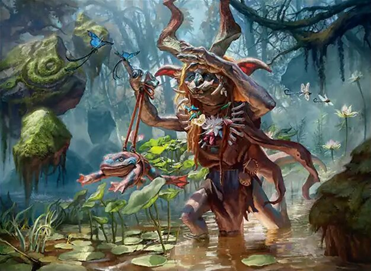

  
Kruk

  

    
    
Kruk, Mestre dos Caçadores

  

  <table>
    <tr><td><b>Tipo</b></td><td>NPC / Caçador</td></tr>
    <tr><td><b>Epíteto</b></td><td>Mestre dos Caçadores</td></tr>
    <tr><td><b>Espécie</b></td><td>Goblin</td></tr>
    <tr><td><b>Gênero</b></td><td>Masculino</td></tr>
    <tr><td><b>Status</b></td><td>Vivo</td></tr>
    <tr><td><b>Tribo</b></td><td><a href="../Tribos/Masca-Musgo" class="internal">Masca-Musgo</a></td></tr>
    <tr><td><b>Local</b></td><td><a href="../Geografia/Raiz-Funda" class="internal">Raiz-Funda</a></td></tr>
    <tr><td><b>Devoção</b></td><td><a href="../Cosmologia/Nyog'Sothep" class="internal">Nyog'Sothep</a></td></tr>
  </table>

# Kruk (Mestre dos Caçadores)

<blockquote class="epigraph">*A preencher.*</blockquote>

**Kruk**, o **Mestre dos Caçadores** de [[Geografia/Raiz-Funda|Raiz-Funda]], conduz as [[Historia/Cacada Sagrada|Caçadas Sagradas]] e garante que os caçadores [[Tribos/Masca-Musgo|Masca-Musgo]] respeitem os limites do pântano e os territórios dos Deuses-Fera.

## Aparência
Veterano de corpo curtido pelo brejo, Kruk tem a pele marcada por cicatrizes antigas de presas, espinhos e armadilhas acumuladas em patrulhas pelos canais e bancos de lodo.

## Personalidade e Maneirismos
Tradicionalista, metódico e cauteloso, Kruk acredita que a tribo só sobrevive enquanto não provoca forças maiores do que suas lanças podem abater. Segue à risca a [[Cosmologia/Lei da Troca|Lei da Troca]], o [[Cosmologia/Codigo de Honra do Fogo|Código de Honra do Fogo]] e as [[Deuses-Fera/Deus-Fera#Regras de Caçada Ninhadas vs. Territórios Sagrados de Desova|regras de ninhadas e territórios sagrados de desova]].

## História
*A preencher.*

## Função e Ocupação
Kruk lidera as [[Historia/Cacada Sagrada|Caçadas Sagradas]] e conhece os canais, bancos de lodo e rastros do [[Geografia/Vale da Lama|Vale da Lama]], incluindo as passagens até o [[Geografia/Delta das Aguas Mortas|Delta das Águas Mortas]]. Conduz os jovens iniciados pela provação que os torna adultos perante [[Cosmologia/Nyog'Sothep|Nyog'Sothep]], exigindo o cumprimento exato do sacrifício da carne e da devolução ao ciclo.

## Relações e Alianças
* **[[NPCs/Grixa|Grixa]]:** Enfrenta oposição direta da batedora de elite. Enquanto Kruk insiste nas rotas conhecidas e na prudência, Grixa pressiona por incursões ousadas nas zonas disputadas do pântano, dividindo a confiança dos caçadores.

## O que se Conta pelo Pântano
* **O Peso das Cicatrizes:** Nas fogueiras de Raiz-Funda, os mais velhos apontam as cicatrizes de Kruk como lembrete do motivo pelo qual não se invade enseada de desova nem se provoca [[Deuses-Fera/Krr'tak|Krr'tak]] sem necessidade.

---

**Veja também:** [[Geografia/Raiz-Funda|Raiz-Funda]] | [[NPCs/Grixa|Grixa]] | [[Historia/Cacada Sagrada|A Caçada Sagrada]] | [[Deuses-Fera/Deus-Fera|Deus-Fera]]
