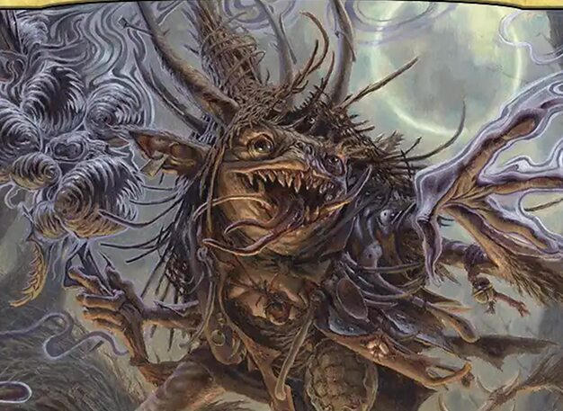

  
Murok

  

    
    
Murok, o Ancião Centenário

  

  <table>
    <tr><td><b>Tipo</b></td><td>NPC / Ancião Vampírico</td></tr>
    <tr><td><b>Epíteto</b></td><td>O Ancião Centenário</td></tr>
    <tr><td><b>Espécie</b></td><td>Goblin</td></tr>
    <tr><td><b>Gênero</b></td><td>Masculino</td></tr>
    <tr><td><b>Status</b></td><td>Vivo (+120 anos)</td></tr>
    <tr><td><b>Tribo</b></td><td><a href="../Tribos/Ventre-Inchado" class="internal">Ventre-Inchado</a></td></tr>
    <tr><td><b>Local</b></td><td><a href="../Geografia/Aguas-Paradas-Profundas" class="internal">Águas Paradas Profundas</a></td></tr>
    <tr><td><b>Devoção</b></td><td><a href="../Deuses-Fera/Sss'kar" class="internal">Sss'kar</a></td></tr>
  </table>

# Murok (o Ancião Centenário)

<blockquote class="epigraph">*A preencher.*</blockquote>

**Murok**, chamado com temor de **Ancião Centenário**, é o mais velho dos anciãos vampíricos dos [[Tribos/Ventre-Inchado|Ventre-Inchado]] e a presença mais inquietante das [[Geografia/Aguas Paradas Profundas|Águas Paradas Profundas]]. Enquanto gerações inteiras nas tribos vizinhas nascem, caçam e retornam ao lodo em poucas décadas, ele desafia o relógio da carne há mais de um século por meio dos rituais secretos de sangue dedicados a [[Deuses-Fera/Sss'kar|Sss'kar]].

## Aparência
Ultrapassados os **120 anos**, Murok foi reduzido a uma figura esquelética e consumida, de pele pálida quase translúcida esticada sobre os ossos. Seus olhos vermelhos retraem-se diante de qualquer claridade direta, adaptados apenas à penumbra úmida e ao silêncio pesado do fundo do brejo.

## Personalidade e Maneirismos
*A preencher.*

## História
*A preencher.*

## Função e Ocupação
Murok raramente abandona sua **câmara semi-submersa escavada sob os bancos de barro** nas profundezas do sul. Ali, na fronteira entre a água parada e a terra encharcada, prolonga a própria existência muito além do limite natural de sua espécie consumindo sangue em rituais secretos para [[Deuses-Fera/Sss'kar|Sss'kar]], atravessando semanas inteiras sem tocar em qualquer alimento sólido.

Para sustentar esses ritos — e alimentar as oferendas exigidas pela sanguessuga Deus-Fera colossal —, os [[Tribos/Ventre-Inchado|Ventre-Inchado]] mantêm criadouros de [[Tribos/Sanguessugas Gigantes|sanguessugas gigantes]] em ânforas de barro e couro úmido, nutrindo o ciclo de sangue que mantém seu ancião vivo na escuridão.

## Relações e Alianças
* **[[Deuses-Fera/Sss'kar|Sss'kar]]:** Dedica seus rituais secretos de sangue à sanguessuga Deus-Fera colossal do sul, atrelando sua longevidade antinatural à fome da divindade.
* **[[Tribos/Ventre-Inchado|Ventre-Inchado]]:** Permanece como o líder mais antigo e reverenciado da tribo reclusa do sul, cuja palavra ecoa das câmaras submersas.

## O que se Conta pelo Pântano
* **O Vivo que Recusa o Retorno:** Para os [[Tribos/Masca-Musgo|Masca-Musgo]], a longevidade de Murok é uma afronta direta à morte e ao *Ciclo da Devolução*. Batedores que vigiam a fronteira sul garantem que ninguém que rema fundo demais nas águas paradas volta inteiro para contar o que respira sob os bancos de barro.

---

**Veja também:** [[Tribos/Ventre-Inchado|Ventre-Inchado]] | [[Geografia/Aguas Paradas Profundas|Águas Paradas Profundas]] | [[Deuses-Fera/Sss'kar|Sss'kar]] | [[Tribos/Sanguessugas Gigantes|Sanguessugas Gigantes]]
