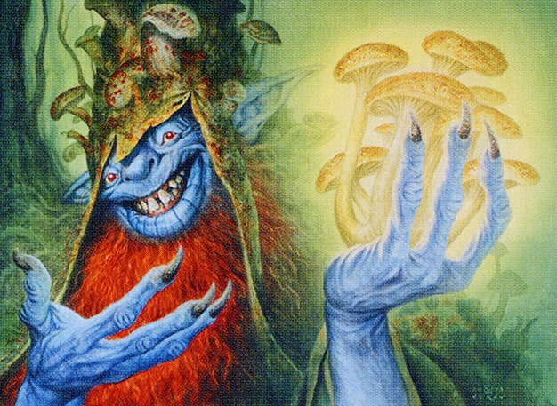

  
Sacerdote-Chefe Malok

  

    
    
Sacerdote-Chefe Malok

  

  <table>
    <tr><td><b>Tipo</b></td><td>NPC / Clero</td></tr>
    <tr><td><b>Epíteto</b></td><td>Sacerdote-Chefe</td></tr>
    <tr><td><b>Espécie</b></td><td>Goblin</td></tr>
    <tr><td><b>Gênero</b></td><td>Masculino</td></tr>
    <tr><td><b>Status</b></td><td>Vivo</td></tr>
    <tr><td><b>Tribo</b></td><td><a href="../Tribos/Masca-Musgo" class="internal">Masca-Musgo</a></td></tr>
    <tr><td><b>Local</b></td><td><a href="../Geografia/Raiz-Funda" class="internal">Raiz-Funda</a></td></tr>
    <tr><td><b>Devoção</b></td><td><a href="../Cosmologia/Nyog'Sothep" class="internal">Nyog'Sothep</a></td></tr>
  </table>

# Sacerdote-Chefe Malok

<blockquote class="epigraph">*A preencher.*</blockquote>

**Sacerdote-Chefe Malok** é o líder espiritual e político dos [[Tribos/Masca-Musgo|Masca-Musgo]] em [[Geografia/Raiz-Funda|Raiz-Funda]]. Sem reis ou coroas, sua autoridade vem da guarda do [[Geografia/Jardim Dourado|Jardim Dourado]] e da custódia do [[Cosmologia/Idolo de Nyog'Sothep|Ídolo de Nyog'Sothep]].

## Aparência
Idoso e encurvado, Malok veste um manto escuro sobre o qual brotam pequenos fungos vivos, mantidos pela umidade constante do pântano.

## Personalidade e Maneirismos
Malok mede cada palavra antes de falar e evita decisões apressadas, consciente de que um erro pode romper a trégua frágil nas fronteiras da aldeia ou provocar o pântano.

## História
*A preencher.*

## Função e Ocupação
À frente do clero de [[Cosmologia/Nyog'Sothep|Nyog'Sothep]] em [[Geografia/Raiz-Funda|Raiz-Funda]], Malok concentra os assuntos sagrados e políticos da tribo. Tem acesso irrestrito ao círculo interno do [[Geografia/Jardim Dourado|Jardim Dourado]] e ao [[Cosmologia/Idolo de Nyog'Sothep|Ídolo de Nyog'Sothep]], comandando **[[Tribos/Jardineiros|Os Jardineiros]]**, ordem de sentinelas separada da guarda regular de [[NPCs/Varga|Varga]].

Fora do santuário, orienta a posição da tribo nas disputas com os [[Tribos/Ferve-Alga (Olhos-Vermelhos)|Ferve-Alga]] e preside julgamentos ligados às leis sagradas.

## Relações e Alianças
* **[[Tribos/Jardineiros|Os Jardineiros]]:** Ordem subordinada a Malok e ao alto clero para guardar o santuário e o Ídolo sem interferência das disputas do cais.
* **[[NPCs/Irmãos Snakk e Drig|Irmãos Snakk e Drig]]:** Supervisiona os coveiros-sacerdotes no *Ciclo da Devolução* e na colheita do [[Cosmologia/Micelio Dourado|Micélio Dourado]].
* **[[NPCs/Zog|Zog]] e [[NPCs/Vó Mofo-Velho|Vó Mofo-Velho]]:** Forma com o xamã animista e a decana o núcleo espiritual e tradicional da tribo.

## O que se Conta pelo Pântano
* **O Manto que Respira:** Caçadores mais novos cochicham que os fungos no manto de Malok florescem mais rápido nos dias em que a névoa do Jardim Dourado engrossa.

---

**Veja também:** [[Geografia/Raiz-Funda|Raiz-Funda]] | [[Cosmologia/Nyog'Sothep|Nyog'Sothep]] | [[Geografia/Jardim Dourado|Jardim Dourado]] | [[Tribos/Jardineiros|Os Jardineiros]] | [[Tribos/Masca-Musgo|Masca-Musgo]] | [[Exilados/Exilados|Exilados]]
