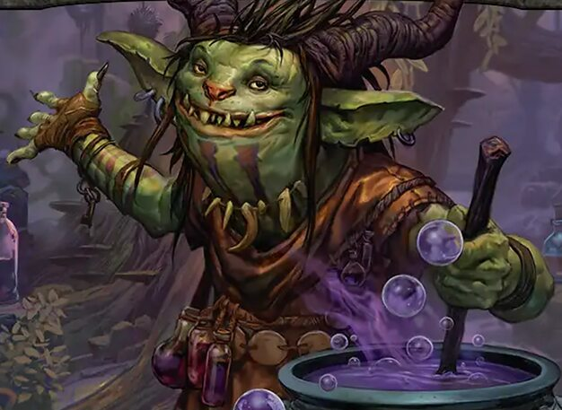

  
Snikk

  

    
    
Snikk, Curandeiro-Chefe

  

  <table>
    <tr><td><b>Tipo</b></td><td>NPC / Curandeiro</td></tr>
    <tr><td><b>Epíteto</b></td><td>Curandeiro-Chefe</td></tr>
    <tr><td><b>Espécie</b></td><td>Goblin</td></tr>
    <tr><td><b>Gênero</b></td><td>Masculino</td></tr>
    <tr><td><b>Status</b></td><td>Vivo</td></tr>
    <tr><td><b>Tribo</b></td><td><a href="../Tribos/Masca-Musgo" class="internal">Masca-Musgo</a></td></tr>
    <tr><td><b>Local</b></td><td><a href="../Geografia/Raiz-Funda" class="internal">Raiz-Funda</a></td></tr>
    <tr><td><b>Devoção</b></td><td><a href="../Cosmologia/Nyog'Sothep" class="internal">Nyog'Sothep</a></td></tr>
  </table>

# Snikk (Curandeiro-Chefe)

<blockquote class="epigraph">*A preencher.*</blockquote>

**Snikk** é o **Curandeiro-Chefe** de [[Geografia/Raiz-Funda|Raiz-Funda]], responsável por manter vivos os caçadores, artesãos e sentinelas dos [[Tribos/Masca-Musgo|Masca-Musgo]] em um pântano onde qualquer corte mal lavado pode apodrecer em questão de dias. É uma das poucas figuras da aldeia autorizadas a cruzar as pontes do círculo interno do [[Geografia/Jardim Dourado|Jardim Dourado]].

## Aparência
*A preencher.*

## Personalidade e Maneirismos
*A preencher.*

## História
*A preencher.*

## Função e Ocupação
O trabalho de Snikk une a botânica do mangue à fé prática em [[Cosmologia/Nyog'Sothep|Nyog'Sothep]], atuando sempre sob a disciplina da [[Tribos/Preparacao a Frio|Preparação a Frio]] e do [[Cosmologia/Codigo de Honra do Fogo|Código de Honra do Fogo]]:
- **Cataplasmas de Micélio Dourado:** Aplicado puro sobre ferimentos graves, o [[Cosmologia/Micelio Dourado|Micélio Dourado]] acelera a regeneração tecidual e contém infecções pantanosas que matariam um ferido comum. Snikk dosa cada aplicação com rigor, ciente do risco da **Ascensão** para quem recebe Micélio em excesso.
- **Ervas do Mangue e Máscaras de Esporos:** É Snikk quem seleciona os feixes secos de ervas amargas e aromáticas usados para rechear as [[Cosmologia/Mascara de Ervas Amargas|Máscaras de Ervas Amargas]], neutralizando o odor doce e sufocante dos esporos no [[Geografia/Jardim Dourado|Jardim Dourado]] e os vapores fétidos dos [[Geografia/Pocos de Turfa e Brejo do Musgo-Negro|Poços de Turfa]].

## Relações e Alianças
* **[[NPCs/Birka|Birka (a Mão-Ácida)]]:** Trabalha em sintonia com a curtidora e alquimista de Raiz-Funda na confecção das [[Cosmologia/Mascara de Ervas Amargas|Máscaras de Ervas Amargas]] — enquanto Birka curte o couro a frio, Snikk prepara as ervas que filtram os esporos.
* **[[NPCs/Irmãos Snakk e Drig|Irmãos Snakk e Drig]]:** Como curandeiro autorizado a entrar no [[Geografia/Jardim Dourado|Jardim Dourado]], cruza frequentemente o caminho dos coveiros-sacerdotes ao obter [[Cosmologia/Micelio Dourado|Micélio Dourado]] fresco — e sabe, melhor do que ninguém, quando um paciente já não pertence mais aos vivos e deve seguir para o *Ciclo da Devolução*.

## O que se Conta pelo Pântano
- **A Mão que Decide:** Entre os caçadores feridos nas fronteiras, diz-se que entrar na cabana de Snikk é descobrir se a dívida com o brejo ainda pode ser adiada com cataplasmas de Micélio — ou se restou apenas esperar pelas águas rasas do Jardim Dourado.

---

**Veja também:** [[Geografia/Raiz-Funda|Raiz-Funda]] | [[Cosmologia/Micelio Dourado|Micélio Dourado]] | [[Geografia/Jardim Dourado|Jardim Dourado]] | [[Cosmologia/Mascara de Ervas Amargas|Máscara de Ervas Amargas]] | [[NPCs/Birka|Birka]]
