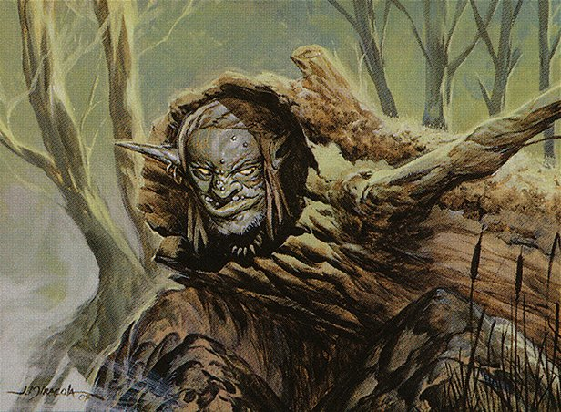

  
Torg

  

    
    
Torg, o Construtor

  

  <table>
    <tr><td><b>Tipo</b></td><td>NPC / Construtor</td></tr>
    <tr><td><b>Epíteto</b></td><td>O Construtor</td></tr>
    <tr><td><b>Espécie</b></td><td>Goblin</td></tr>
    <tr><td><b>Gênero</b></td><td>Masculino</td></tr>
    <tr><td><b>Status</b></td><td>Vivo</td></tr>
    <tr><td><b>Tribo</b></td><td><a href="../Tribos/Masca-Musgo" class="internal">Masca-Musgo</a></td></tr>
    <tr><td><b>Local</b></td><td><a href="../Geografia/Raiz-Funda#o-cais-das-jangadas-e-oficinas" class="internal">Cais das Jangadas (Raiz-Funda)</a></td></tr>
    <tr><td><b>Devoção</b></td><td><a href="../Cosmologia/Nyog'Sothep" class="internal">Nyog'Sothep</a></td></tr>
  </table>

# Torg

<blockquote class="epigraph">*A preencher.*</blockquote>

**Torg** ergue e sustenta as palafitas, passarelas de tábuas e pontes de corda que mantêm [[Geografia/Raiz-Funda|Raiz-Funda]] acima da lama entre os Cogumelos Nodosos e as raízes do mangue. Sem seu trabalho contínuo contra a umidade que tudo amolece, a aldeia inteira cederia ao brejo em poucas estações.

## Aparência
*A preencher.*

## Personalidade e Maneirismos
*A preencher.*

## História
*A preencher.*

## Função e Ocupação
Junto ao [[Geografia/Raiz-Funda#O Cais das Jangadas e Oficinas|Cais das Jangadas e Oficinas]], Torg trabalha segundo a [[Tribos/Preparacao a Frio|Preparação a Frio]] e a [[Cosmologia/Lei da Troca|Lei da Troca]]:
- **Palafitas e Passarelas:** Troca tábuas podres, impermeabiliza madeira de mangue com resina e trança cordas para manter as rotas elevadas firmes sobre os canais de lama.
- **Jangadas e Piche:** Constrói e repara jangadas de fundo chato para navegar pelas águas paradas, calafetando a madeira a frio com piche natural extraído com varas longas nos [[Geografia/Pocos de Turfa e Brejo do Musgo-Negro|Poços de Turfa]].
- **Calçados de Brejo:** Faz botas largas de couro e madeira e raquetes de mangue para distribuir o peso e poupar força nas marchas sobre a lama profunda do [[Geografia/Vale da Lama|Vale da Lama]].

## Relações e Alianças
* **[[NPCs/Birka|Birka (a Mão-Ácida)]]:** Divide o cais das oficinas, usando couros curtidos por Birka em botas e amarrações.
* **[[NPCs/Zog|Zog]]:** Como toda madeira cortada e toda jangada lançada às águas carrega a memória do brejo pelo [[Cosmologia/Animismo|Animismo]], Torg cumpre a [[Cosmologia/Lei da Troca|Lei da Troca]] em suas coletas — e chama Zog quando algum material dá sinais de rejeição.
* **[[Deuses-Fera/Suuhr|Suuhr]]:** Quem parte para extrair piche no Brejo do Musgo-Negro leva oferendas de caça fresca — sobretudo sapos e coelhos — para apaziguar a cobra de piche líquido.

## O que se Conta pelo Pântano
- **Madeira com Memória:** No cais, diz-se que Torg reconhece pelo som seco do martelo quando uma tábua foi cortada sem cumprir a Lei da Troca — e se recusa a pregá-la em qualquer passarela de Raiz-Funda.

---

**Veja também:** [[Geografia/Raiz-Funda|Raiz-Funda]] | [[Geografia/Pocos de Turfa e Brejo do Musgo-Negro|Poços de Turfa e Brejo do Musgo-Negro]] | [[Tribos/Preparacao a Frio|Preparação a Frio]] | [[Tribos/Masca-Musgo|Masca-Musgo]] | [[Deuses-Fera/Suuhr|Suuhr]]
