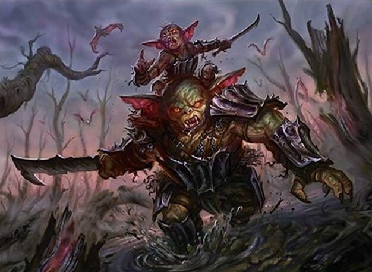

  
Varga

  

    
    
Varga, Capitã da Guarda

  

  <table>
    <tr><td><b>Tipo</b></td><td>NPC / Militar</td></tr>
    <tr><td><b>Epíteto</b></td><td>Capitã da Guarda</td></tr>
    <tr><td><b>Espécie</b></td><td>Goblin</td></tr>
    <tr><td><b>Gênero</b></td><td>Feminino</td></tr>
    <tr><td><b>Status</b></td><td>Vivo</td></tr>
    <tr><td><b>Tribo</b></td><td><a href="../Tribos/Masca-Musgo" class="internal">Masca-Musgo</a></td></tr>
    <tr><td><b>Local</b></td><td><a href="../Geografia/Raiz-Funda" class="internal">Raiz-Funda</a></td></tr>
    <tr><td><b>Devoção</b></td><td><a href="../Cosmologia/Nyog'Sothep" class="internal">Nyog'Sothep</a></td></tr>
  </table>

# Varga (Capitã da Guarda)

<blockquote class="epigraph">*A preencher.*</blockquote>

**Varga**, a **Capitã da Guarda** de [[Geografia/Raiz-Funda|Raiz-Funda]], transforma o mangue ancestral e os canais de lama ao redor da aldeia em uma barreira viva e silenciosa. Sob seu comando, raízes retorcidas e águas paradas deixam de ser apenas refúgio para se tornarem armadilha contra invasores, predadores e exilados que ousem tentar o caminho de volta.

## Aparência
*A preencher.*

## Personalidade e Maneirismos
Pragmática, severa e avessa a concessões, Varga não negocia quando o assunto toca a segurança das palafitas e as leis da tribo. Para ela, cada brecha tolerada hoje é um cadáver boiando nos canais amanhã.

## História
*A preencher.*

## Função e Ocupação
Varga comanda toda a defesa periférica de [[Geografia/Raiz-Funda|Raiz-Funda]]. Posiciona batedores e sentinelas no alto das arcadas de mangue, mantendo vigília contínua por meio de códigos de assobios que imitam aves e anfíbios do pântano para anunciar movimentos sem alertar quem se aproxima.

Sob a lâmina d'água escura, suas patrulhas mantêm as trilhas submersas sinalizadas apenas por estacas de osso, enquanto cercam os acessos externos da aldeia com armadilhas de brejo — redes de cipó trançado e estacas ocultas prontas para rasgar quem desviar do caminho certo.

## Relações e Alianças
* **[[Exilados/Exilados|Exilados]]:** Sob suas ordens diretas, as sentinelas recebem qualquer exilado que tente se reaproximar de Raiz-Funda com flechas de aviso fincadas na lama — e atiram para matar se o banido insistir em avançar um passo.
* **[[Tribos/Jardineiros|Os Jardineiros]]:** A autoridade da guarda regular de Varga cessa exatamente nos limites externos do [[Geografia/Jardim Dourado|Jardim Dourado]]. Além daquelas pontes, a proteção do santuário e do [[Cosmologia/Idolo de Nyog'Sothep|Ídolo de Nyog'Sothep]] pertence exclusivamente aos Jardineiros, subordinados ao alto clero.

## O que se Conta pelo Pântano
* **O Som antes da Flecha:** Quem se aproxima de Raiz-Funda fora das trilhas marcadas aprende cedo a distinguir o canto real de uma ave do assobio curto e seco das sentinelas de Varga — e descobre ainda mais depressa que um segundo aviso raramente vem sem uma ponta de osso cortando a neblina.

---

**Veja também:** [[Geografia/Raiz-Funda|Raiz-Funda]] | [[Tribos/Masca-Musgo|Masca-Musgo]] | [[Exilados/Exilados|Exilados]] | [[Tribos/Jardineiros|Os Jardineiros]]
