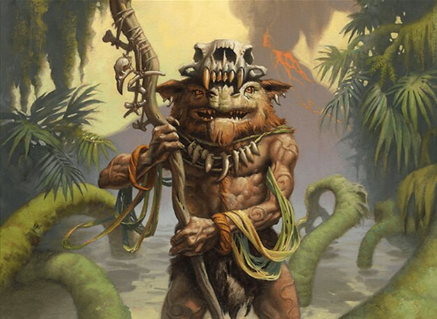

  
Velho Rói-Raiz

  

    
    
Velho Rói-Raiz

  

  <table>
    <tr><td><b>Tipo</b></td><td>NPC / Ancião e Juiz</td></tr>
    <tr><td><b>Epíteto</b></td><td>Juiz das Disputas</td></tr>
    <tr><td><b>Espécie</b></td><td>Goblin</td></tr>
    <tr><td><b>Gênero</b></td><td>Masculino</td></tr>
    <tr><td><b>Status</b></td><td>Vivo</td></tr>
    <tr><td><b>Tribo</b></td><td><a href="../Tribos/Masca-Musgo" class="internal">Masca-Musgo</a></td></tr>
    <tr><td><b>Local</b></td><td><a href="../Geografia/Raiz-Funda#a-casa-do-ancião" class="internal">Casa do Ancião (Raiz-Funda)</a></td></tr>
    <tr><td><b>Devoção</b></td><td><a href="../Cosmologia/Nyog'Sothep" class="internal">Nyog'Sothep</a></td></tr>
  </table>

# Velho Rói-Raiz (Juiz das Disputas)

<blockquote class="epigraph">*A preencher.*</blockquote>

**Velho Rói-Raiz**, o **Juiz das Disputas** de [[Geografia/Raiz-Funda|Raiz-Funda]], sustenta o peso da lei onde não há celas nem correntes. Diante da aldeia reunida, decide conflitos internos, quebras de reciprocidade e crimes com fogo. Dividindo a [[Geografia/Raiz-Funda#A Casa do Ancião|Casa do Ancião]] com [[NPCs/Vó Mofo-Velho|Vó Mofo-Velho]], traça os limites severos que mantêm os [[Tribos/Masca-Musgo|Masca-Musgo]] inteiros por dentro.

## Aparência
*A preencher.*

## Personalidade e Maneirismos
Austero, seco e implacavelmente imparcial, Velho Rói-Raiz não abranda sentenças por parentesco, dívida antiga ou prestígio de caça. Sua voz corta desculpas com a frieza de quem sabe que uma infração tolerada corrói toda a aldeia.

## História
*A preencher.*

## Função e Ocupação
Junto à [[Geografia/Raiz-Funda#A Casa do Ancião|Casa do Ancião]], diante da comunidade reunida, Velho Rói-Raiz arbitra conflitos entre moradores e julga quebras à [[Cosmologia/Lei da Troca|Lei da Troca]], completando no plano social a orientação espiritual dada por [[NPCs/Zog|Zog]].

Quando a falta envolve o fogo, aplica sem vacilar as penas do [[Cosmologia/Codigo de Honra do Fogo|Código de Honra do Fogo]] — desde o confisco de inflamáveis e a **[[Cosmologia/Sentenca do Esquecimento|Marca de Cinza Fria]]** na testa de forasteiros até a temida **Sentença do Esquecimento** contra quem usa chamas para matar, ferir, punir ou cremar corpos. É também da sua boca que saem os banimentos definitivos que transformam infratores graves em [[Exilados/Exilados|Exilados]] sem caminho de volta.

## Relações e Alianças
* **[[NPCs/Vó Mofo-Velho|Vó Mofo-Velho]]:** Divide a Casa do Ancião com a decana da tribo, unindo a memória oral dos tempos antigos ao peso implacável do julgamento.
* **[[NPCs/Zog|Zog]]:** Enquanto Zog aponta o que foi rompido com o pântano e que restituição o solo exige, Rói-Raiz arbitra as consequências humanas dentro da aldeia.
* **[[Exilados/Exilados|Exilados]]:** Pronunciou os banimentos de todos os expulsos de Raiz-Funda — sentenças secas que jamais foram revertidas.

## O que se Conta pelo Pântano
* **Sentença Sem Volta:** Forasteiros que sobem à Casa do Ancião aprendem depressa que não existe barganha possível com Velho Rói-Raiz. Nas passarelas de Raiz-Funda, nunca houve perdão depois que o juiz declarou o banimento.

---

**Veja também:** [[Geografia/Raiz-Funda|Raiz-Funda]] | [[Cosmologia/Codigo de Honra do Fogo|Código de Honra do Fogo]] | [[Cosmologia/Sentenca do Esquecimento|Sentença do Esquecimento]] | [[Cosmologia/Lei da Troca|Lei da Troca]] | [[Exilados/Exilados|Exilados]]
