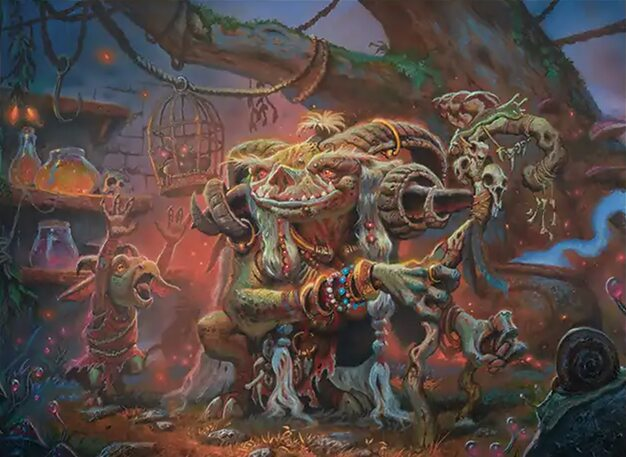

  
Vó Mofo-Velho

  

    
    
Vó Mofo-Velho

  

  <table>
    <tr><td><b>Tipo</b></td><td>NPC / Anciã</td></tr>
    <tr><td><b>Epíteto</b></td><td>Decana</td></tr>
    <tr><td><b>Espécie</b></td><td>Goblin</td></tr>
    <tr><td><b>Gênero</b></td><td>Feminino</td></tr>
    <tr><td><b>Status</b></td><td>Vivo</td></tr>
    <tr><td><b>Tribo</b></td><td><a href="../Tribos/Masca-Musgo" class="internal">Masca-Musgo</a></td></tr>
    <tr><td><b>Local</b></td><td><a href="../Geografia/Raiz-Funda#a-casa-do-ancião" class="internal">Casa do Ancião (Raiz-Funda)</a></td></tr>
    <tr><td><b>Devoção</b></td><td><a href="../Cosmologia/Nyog'Sothep" class="internal">Nyog'Sothep</a></td></tr>
  </table>

# Vó Mofo-Velho (Decana)

**Vó Mofo-Velho** é a habitante mais antiga de [[Geografia/Raiz-Funda|Raiz-Funda]] e ocupa o papel de **Decana** da tribo [[Tribos/Masca-Musgo|Masca-Musgo]].

## Aparência
*A preencher.*

## Personalidade e Maneirismos
*A preencher.*

## História
*A preencher.*

## Função e Ocupação
Reside na [[Geografia/Raiz-Funda#A Casa do Ancião|Casa do Ancião]], onde recebe visitantes e guarda a memória oral da [[Historia/A Grande Morte Lenta|Grande Morte Lenta]], da Traição das Escamas e das tradições ancestrais. Possui acesso autorizado ao círculo interno do [[Geografia/Jardim Dourado|Jardim Dourado]].

## Relações e Alianças
* **[[NPCs/Velho Rói-Raiz|Velho Rói-Raiz]]:** Divide a Casa do Ancião com o Juiz das Disputas.

## O que se Conta pelo Pântano
*A preencher.*

---

**Veja também:** [[Geografia/Raiz-Funda|Raiz-Funda]] | [[Historia/A Grande Morte Lenta|A Grande Morte Lenta]] | [[Geografia/Jardim Dourado|Jardim Dourado]]
