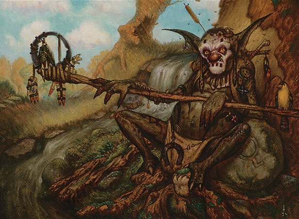

  
Zog

  

    
    
Zog, o Voz-de-Esporo

  

  <table>
    <tr><td><b>Tipo</b></td><td>NPC / Xamã Animista</td></tr>
    <tr><td><b>Epíteto</b></td><td>Voz-de-Esporo</td></tr>
    <tr><td><b>Espécie</b></td><td>Goblin</td></tr>
    <tr><td><b>Gênero</b></td><td>Masculino</td></tr>
    <tr><td><b>Status</b></td><td>Vivo</td></tr>
    <tr><td><b>Tribo</b></td><td><a href="../Tribos/Masca-Musgo" class="internal">Masca-Musgo</a></td></tr>
    <tr><td><b>Local</b></td><td><a href="../Geografia/Raiz-Funda" class="internal">Raiz-Funda</a></td></tr>
    <tr><td><b>Devoção</b></td><td><a href="../Cosmologia/Nyog'Sothep" class="internal">Nyog'Sothep</a></td></tr>
  </table>

# Zog (Voz-de-Esporo)

**Zog**, conhecido como **Voz-de-Esporo**, é o xamã animista de [[Geografia/Raiz-Funda|Raiz-Funda]].

## Aparência
Anda coberto de amuletos de dentes, conchas e ossos que tilintam a cada passo.

## Personalidade e Maneirismos
*A preencher.*

## História
*A preencher.*

## Função e Ocupação
- **Lei da Troca:** Conhece profundamente a [[Cosmologia/Lei da Troca|Lei da Troca]] e orienta caçadores e viajantes sobre como pedir passagem, oferendar ao pântano e reparar quebras de reciprocidade.
- **Visões de Musgo:** Conduz rituais em que pequenas lascas de [[Cosmologia/Micelio Dourado|Micélio Dourado]] são mascadas para sentir as correntes vivas do micélio subterrâneo de [[Cosmologia/Nyog'Sothep|Nyog'Sothep]].

## Relações e Alianças
*A preencher.*

## O que se Conta pelo Pântano
*A preencher.*

---

**Veja também:** [[Geografia/Raiz-Funda|Raiz-Funda]] | [[Cosmologia/Animismo|Animismo]] | [[Cosmologia/Lei da Troca|Lei da Troca]] | [[Cosmologia/Micelio Dourado|Micélio Dourado]]
