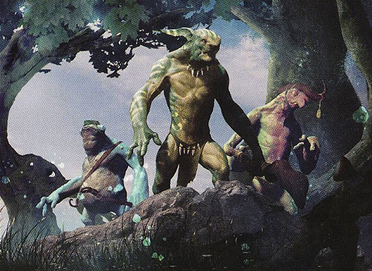

  
Masca-Musgo

  

    
    
Guerreiros e batedores Masca-Musgo

  

  <table>
    <tr><td><b>Tipo</b></td><td>Facção / Tribo do Oeste</td></tr>
    <tr><td><b>Território</b></td><td>Oeste do <a href="../Geografia/Vale-da-Lama" class="internal">Vale da Lama</a></td></tr>
    <tr><td><b>Base</b></td><td><a href="../Geografia/Raiz-Funda" class="internal">Raiz-Funda</a></td></tr>
    <tr><td><b>Devoção</b></td><td><a href="../Cosmologia/Nyog'Sothep" class="internal">Nyog'Sothep</a></td></tr>
    <tr><td><b>Liderança</b></td><td><a href="../NPCs/Sacerdote-Chefe-Malok" class="internal">Sacerdote-Chefe Malok</a></td></tr>
    <tr><td><b>Relações</b></td><td>Comércio com <a href="../Tribos/Tece-Pele" class="internal">Tece-Pele</a>; trégua tensa com <a href="../Tribos/Ferve-Alga-(Olhos-Vermelhos)" class="internal">Ferve-Alga</a>; evitam <a href="../Tribos/Ventre-Inchado" class="internal">Ventre-Inchado</a></td></tr>
  </table>

# Masca-Musgo

<blockquote class="epigraph">"Nenhuma corrente enferruja tão rápido quanto o ferro que afunda no lodo. Caíram as asas de fogo, calaram-se os rugidos da serra, e sobre os ossos dos tiranos brotou o ouro silencioso que nos alimenta. Não temos reis, não temos muralhas e não tememos o escuro: mastigamos o musgo, honramos a troca e caminhamos livres onde nenhum pé estranho ousa afundar." — <a href="../NPCs/Vó-Mofo-Velho" class="internal">Vó Mofo-Velho</a>, Decana de Raiz-Funda</blockquote>

Os **Masca-Musgo** são a principal tribo goblin do setor oeste do [[Geografia/Vale da Lama|Vale da Lama]]. Concentrados entre os cogumelos gigantes e as águas paradas de [[Geografia/Raiz-Funda|Raiz-Funda]], carregam no próprio nome a lembrança de tempos de fome e cativeiro — e na fé em [[Cosmologia/Nyog'Sothep|Nyog'Sothep]], a certeza de que a liberdade foi arrancada à força das garras de antigos senhores. Para os Masca-Musgo, o pântano não é um refúgio pacífico nem um terreno morto a ser conquistado: é uma presença atenta que alimenta quem a respeita e engole quem esquece o próprio lugar.

## Aparência e Traços
À primeira vista, um Masca-Musgo parece ter sido moldado pela própria penumbra do brejo. Têm pele esverdeada-acinzentada, marcada por manchas inofensivas de líquen, cicatrizes antigas de espinhos e um cheiro permanente de terra úmida, resina de mangue e fermentação. Seus dentes são escurecidos pelo hábito incessante de mascar raízes moles, ervas amargas e musgos suaves — costume que alivia a fome das marchas longas e mantém a boca úmida no ar pesado do vale. Os olhos grandes e atentos enxergam com facilidade sob a sombra fechada dos chapéus dos Cogumelos Nodosos.

Na aldeia, o ofício de cada goblin se lê antes mesmo de ele falar. Os que trabalham nos tonéis do cais trazem os dedos manchados por ácidos vegetais e taninos; os que lidam com os ritos do solo carregam colares de dentes, conchas e ossos pequenos que tilintam baixo na neblina; batedores e sentinelas vestem couros curtidos a frio e carregam [[Cosmologia/Mascara de Ervas Amargas|Máscaras de Ervas Amargas]] penduradas ao peito, prontas para quando o ar se torna espesso demais perto dos esporos ou das bolsas de gás do oeste.

## Cultura e Crenças

### Gratidão e Medo diante de Nyog'Sothep
A devoção dos Masca-Musgo a [[Cosmologia/Nyog'Sothep|Nyog'Sothep]] nasce de uma tensão que jamais se resolve: **gratidão absoluta e temor constante**. Eles sabem, porque os antigos repetem junto às passarelas de madeira desde a infância, que nenhum goblin teria sobrevivido às minas sem o Deus Fúngico. Foi ele quem se revelou no [[Cosmologia/Idolo de Nyog'Sothep|Ídolo]] escondido na pedra, quem entregou o [[Cosmologia/Micelio Dourado|Micélio Dourado]] aos escravizados e quem, sob a Lua Nova, deu forças para que derrubassem o [[Tribos/Povo Dragão|Povo Dragão]]. Cada colheita nos canteiros subterrâneos, cada ferida fechada com fungo vivo e cada criança que cresce livre fora das correntes é celebrada como dívida de gratidão.

Mas ninguém em Raiz-Funda confunde gratidão com intimidade segura. Como [[Cosmologia/Deus Verdadeiro|Deus Verdadeiro]], Nyog'Sothep é vasto demais para ouvir súplicas como um chefe de guerra ou poupar um devoto por afeição pessoal. Ele é a **digestão sagrada** do mundo: tudo o que respira, caminha ou rasteja carrega apenas um empréstimo breve de carne e osso, e cedo ou tarde o pântano vem cobrar o retorno. Quando o ar pesa de repente e a **Manifestação do Enxame** — uma nuvem densa de moscas negras e dourado-metálicas — brota da lama úmida com um zumbido que faz vibrar os ossos do crânio, toda a aldeia emudece. Ser tocado pelo enxame sem receber picadas é tido como bênção rara; ainda assim, até os sacerdotes sabem que estão diante de uma força que não distingue o vivo do morto quando chega a hora da devolução.

### A Caçada Sagrada
Mais do que um simples rito de passagem, a **[[Historia/Cacada Sagrada|Caçada Sagrada]]** é o coração da memória ativa dos Masca-Musgo. Nela, os goblins relembram — **em memória e em ato** — a caçada aos [[Tribos/Povo Dragão|Dragões Vermelhos]], seus antigos inimigos e opressores. Não se trata apenas de provar destreza com a lança na lama profunda, mas de reviver o momento em que a presa aprendeu a caçar seu antigo algoz.

Durante a expedição, os caçadores seguem sem fogo em combate, confiando no silêncio, na leitura das águas e no trabalho em grupo. Quando a presa tomba, a carne é sacrificada em gratidão pelo que já foi conquistado na libertação do oeste e pelo que ainda há de ser feito para manter a tribo livre e inteira. Ao concluir o rito com honra, todo jovem deixa de ser apenas mais uma boca na aldeia e entra na vida adulta já reconhecido por [[Cosmologia/Nyog'Sothep|seu Deus]] como **valente, honrado e grato pelo que tem** — digno de caminhar entre os seus e de um dia retornar ao solo sob o olhar da tribo.

### O Jardim Dourado e os Ritos Sagrados
No coração de [[Geografia/Raiz-Funda|Raiz-Funda]], sob o entrelaçado mais antigo do mangue, ergue-se o **[[Geografia/Jardim Dourado|Jardim Dourado]]** — santuário, necrópole e fonte viva da fé dos Masca-Musgo. É ali que repousa o [[Cosmologia/Idolo de Nyog'Sothep|Ídolo de Nyog'Sothep]], protegido pelos [[Tribos/Jardineiros|Jardineiros]] — uma ordem própria de guardas subordinada diretamente ao alto clero —, e onde a bioluminescência âmbar do [[Cosmologia/Micelio Dourado|Micélio Dourado]] ilumina as águas rasas e o ar doce e espesso de esporos. Mesmo entre os da tribo, o círculo interno é interditado à maioria: apenas [[NPCs/Sacerdote-Chefe Malok|Malok]], os coveiros [[NPCs/Irmãos Snakk e Drig|Snakk e Drig]], a decana [[NPCs/Vó Mofo-Velho|Vó Mofo-Velho]] e curandeiros autorizados como [[NPCs/Snikk|Snikk]] podem cruzar suas pontes — sempre protegidos por [[Cosmologia/Mascara de Ervas Amargas|Máscaras de Ervas Amargas]] quando a nuvem de esporos se adensa.

É em torno do Jardim Dourado que giram os ritos que estruturam a vida e a morte da tribo:
- **O Ciclo da Devolução:** Para os Masca-Musgo, queimar um cadáver ou encerrá-lo em pedra seca é o pior tipo de roubo: é negar ao pântano o alimento que sustenta os vivos. Quando alguém da tribo morre, os [[NPCs/Irmãos Snakk e Drig|Irmãos Snakk e Drig]] lavam o corpo com água de mangue, retiram metais e couros curtidos e o conduzem pelo [[Cosmologia/Nyog'Sothep#O Ciclo da Devolução|Ciclo da Devolução]] nos leitos de turfa do Jardim Dourado. Durante *O Inchaço* (dias 1 a 3), a carne amolece; na *Floração* (dias 4 a 12), os coveiros-sacerdotes leem nos desenhos do bolor âmbar e esbranquiçado a memória e a honra do falecido; no *Retorno* (após o 13º dia), os ossos limpos afundam na turfa ou são recolhidos para virar ferramentas úteis à aldeia enquanto a consciência do morto se dissolve no micélio.
- **Ritos de Visão, Cura e Ascensão:** O [[Cosmologia/Micelio Dourado|Micélio Dourado]] cultivado nos canteiros do santuário une o sagrado ao cotidiano. Aplicado puro por curandeiros como [[NPCs/Snikk|Snikk]], fecha feridas abertas e contém infecções do brejo; mascado em lascas mínimas nos rituais conduzidos por [[NPCs/Zog|Zog]], permite sentir as correntes subterrâneas do micélio e receber visões do ciclo. Contudo, quem abusa da dádiva descobre o outro lado do deus: filamentos dourados brotam sob as unhas e a pele, até o portador perder a fala e caminhar sozinho pelas pontes do Jardim Dourado na chamada **Ascensão**, deitando-se entre as raízes para se unir ao solo para sempre.

### A Lei da Troca e o Animismo
Guiados por uma visão [[Cosmologia/Animismo|animista]], os Masca-Musgo entendem o pântano não como um estoque de recursos, mas como uma teia de vontades e memórias. Nessa filosofia, nada pertence a ninguém de forma definitiva: tomar uma vida, cortar uma raiz ou abrir passagem por águas antigas cria uma dívida silenciosa com o lugar. Uma jangada guarda a lembrança da árvore que cedeu a madeira; uma ponta de osso carrega o peso da fera que a perdeu.

A [[Cosmologia/Lei da Troca|Lei da Troca]] é a lembrança constante dessa medida — o gesto pelo qual o goblin reconhece que só pode receber do brejo enquanto aceitar devolver a ele, mantendo o equilíbrio entre o que se tira e o que permanece vivo. Ignorar essa regra é convidar o pântano a fechar as trilhas sob os pés e fazer o couro e a madeira apodrecerem antes da hora.

### O Código de Honra do Fogo e a Preparação a Frio
Nascido da memória da tirania do [[Tribos/Povo Dragão|Povo Dragão]], o [[Cosmologia/Codigo de Honra do Fogo|Código de Honra do Fogo]] condena o fogo usado como instrumento de **combate, punição e dor**, bem como a **destruição intencional do solo, das plantas e da carne** — pois queimar um corpo ou esterilizar a terra nega ao pântano aquilo que pertence ao ciclo.

Os Masca-Musgo reconhecem e aceitam o caráter transformativo do fogo na alquimia, no artesanato e no preparo de alimentos. Ainda assim, seu uso não é uma prática tão enraizada no cotidiano da tribo quanto a [[Tribos/Preparacao a Frio|Preparação a Frio]]: seja pela umidade constante sob os mangues e Cogumelos Nodosos, seja pela cautela herdada de manter a chama sempre contida e subordinada à ferramenta, como ocorre na [[Geografia/Raiz-Funda#A Forja Periférica de Gnarl|Forja Periférica de Gnarl]]. Fermentação em ácidos naturais, curtume com taninos, elixires frios e trabalho em osso e madeira formam a espinha dorsal do cotidiano da aldeia.

### Orgulho, Pertencimento e o Peso do Exílio
Entre os Masca-Musgo, o senso de pertencimento nasce da memória compartilhada de quem sobreviveu unido. Eles carregam um orgulho silencioso por não terem copiado a crueldade de seus antigos mestres: recusam o fogo como arma de suplício, dividem a proteção das passarelas e mantêm viva a história dos que tombaram para que a tribo chegasse ao oeste. Pertencer a Raiz-Funda significa ter lugar entre os Cogumelos Nodosos em vida e ter o corpo devolvido com honra no Jardim Dourado após a morte.

Justamente porque a coesão interna garante a sobrevivência no pântano, romper esse pacto corta o laço de forma irreversível. Infrações menores de forasteiros recebem de [[NPCs/Velho Rói-Raiz|Velho Rói-Raiz]] a **[[Cosmologia/Sentenca do Esquecimento|Marca de Cinza Fria]]** e o confisco de inflamáveis; crimes capitais com fogo levam à **Sentença do Esquecimento**, apagando o nome do culpado dos cantos da aldeia. Aqueles que são expulsos passam a formar os [[Exilados/Exilados|Exilados]]: nunca houve um caso de perdão ou retorno. Quem tenta se reaproximar de [[Geografia/Raiz-Funda|Raiz-Funda]] é recebido por flechas de aviso das sentinelas de [[NPCs/Varga|Varga]] — e morto se der um passo além do aviso.

## História
O nome **Masca-Musgo** precede a própria descoberta do [[Cosmologia/Micelio Dourado|Micélio Dourado]]. Durante a era da escravidão do fogo e da escassez nas [[Geografia/Montanhas do Oeste|Montanhas do Oeste]] e em seus arredores, os goblins não tinham muita escolha do que comer, e o musgo comum raspado das pedras úmidas era uma de suas principais fontes de alimento. Longe de ser motivo de vergonha, o antigo apelido foi preservado com orgulho como lembrança de quem eram quando nada possuíam além da própria teimosia em continuar vivos.

A virada começou nas profundezas das minas, quando encontraram o [[Cosmologia/Idolo de Nyog'Sothep|Ídolo de Nyog'Sothep]] e receberam as visões febris do Micélio Dourado. Durante vinte anos — a [[Historia/A Grande Morte Lenta|Grande Morte Lenta]] — espalharam esporos em silêncio pelas câmaras dos Dragões Vermelhos, minando pouco a pouco a força dos antigos opressores. Quando o dragão jovem Vexar adoeceu rápido demais e a guerra estourou na Batalha da Lua Nova, o poder do Micélio potencializado pela lua pôs os tiranos em fuga para o leste. Perseguindo e exterminando cada dragão na **Primeira Caçada Sagrada**, os sobreviventes fundaram [[Geografia/Raiz-Funda|Raiz-Funda]] no setor oeste do pântano e adotaram o Micélio Dourado como substância sagrada de [[Cosmologia/Nyog'Sothep|Nyog'Sothep]], mantendo vivo o nome ancestral da tribo.

## Organização e Ocupações
A sociedade Masca-Musgo se organiza em [[Geografia/Raiz-Funda|Raiz-Funda]], aldeia construída primariamente em habitações escavadas nos imensos Cogumelos Nodosos e palafitas ligadas por passarelas sobre a lama:

1. **[[NPCs/Sacerdote-Chefe Malok|Sacerdote-Chefe Malok]]** — líder espiritual e político máximo, autoridade central junto ao [[Geografia/Jardim Dourado|Jardim Dourado]].
2. **[[NPCs/Zog|Zog (Voz-de-Esporo)]]** — xamã animista, intérprete dos sinais do pântano e conselheiro da [[Cosmologia/Lei da Troca|Lei da Troca]].
3. **[[NPCs/Irmãos Snakk e Drig|Irmãos Snakk e Drig]]** — Coveiros-Sacerdotes que conduzem o Ciclo da Devolução e colhem o [[Cosmologia/Micelio Dourado|Micélio Dourado]].
4. **[[NPCs/Vó Mofo-Velho|Vó Mofo-Velho]]** — Decana da aldeia e guardiã da memória oral na Casa do Ancião.
5. **[[NPCs/Velho Rói-Raiz|Velho Rói-Raiz]]** — Juiz das Disputas, responsável pelas sentenças e banimentos.
6. **[[NPCs/Varga|Varga]]** — Capitã da Guarda, comandante dos vigias nas arcadas e das defesas periféricas.
7. **[[NPCs/Kruk|Kruk]]** — Mestre dos Caçadores, defensor das regras tradicionais de caçada.
8. **[[NPCs/Grixa|Grixa]]** — Batedora de Elite, rival direta de Kruk pela liderança das expedições.
9. **[[NPCs/Snikk|Snikk]]** — Curandeiro-Chefe, autorizado a entrar no Jardim Dourado para tratar ferimentos e doenças.
10. **[[NPCs/Birka|Birka (a Mão-Ácida)]]** — alquimista, curtidora a frio e principal ponte comercial da tribo.
11. **[[NPCs/Gnarl Martelo-Torto|Gnarl Martelo-Torto]]** — ferreiro da Forja Periférica, especialista em metal recuperado, madeira e osso.
12. **[[NPCs/Torg|Torg]]** — construtor responsável por palafitas, pontes, jangadas calafetadas e calçados de brejo.

## Relações e Diplomacia
Todo comércio no vale funciona inteiramente por **escambo**, sem qualquer moeda comum:
- **[[Tribos/Tece-Pele|Tece-Pele]]:** Mantêm trocas regulares de peles curtidas e reagentes alquímicos (negociados por [[NPCs/Birka|Birka]]) em troca de fios da [[Tribos/Teia Prateada|Teia Prateada]] e informações do pântano.
- **[[Tribos/Ferve-Alga (Olhos-Vermelhos)|Ferve-Alga (Olhos-Vermelhos)]]:** Preservam uma trégua tensa, marcada pelo desconforto diante das grandes fogueiras dos caldeirões de salmoura e por atritos frequentes na manutenção das fronteiras entre os territórios — desrespeitadas com frequência de ambos os lados, mas difíceis de punir.
- **[[Tribos/Ventre-Inchado|Ventre-Inchado]]:** Raramente interagem com o restante dos povos do vale e são deliberadamente evitados pelos Masca-Musgo, que veem a busca por longevidade através do sangue como o avesso do Ciclo da Devolução.

## O que se Conta pelo Pântano
- **A Fronteira com Krr'tak:** Batedores evitam provocar [[Deuses-Fera/Krr'tak|Krr'tak (a Espadachim)]], que habita entre o território Masca-Musgo e o dos Ferve-Alga; dizem que ela acha péssimo o gosto de goblins e evita matá-los por uma dívida antiga com [[Cosmologia/Nyog'Sothep|Nyog'Sothep]], mas seu humor violento não hesita em ceifar quem cruza seu caminho.
- **As Pedras Mortas e o Lago:** Os Masca-Musgo evitam tanto o [[Geografia/Lago da Grande Tirana|Lago da Grande Tirana]] (palco de lutas entre feras espirituais, predadores sedentos e território de [[Deuses-Fera/Og'gath|Og'gath]]) quanto as [[Geografia/Ruinas dos Sem-Nome|Ruínas dos Sem-Nome]], por medo e superstição de criaturas de fogo e fumaça nos túneis ocultos.
- **Oferendas no Brejo do Musgo-Negro:** Quem parte para os [[Geografia/Pocos de Turfa e Brejo do Musgo-Negro|Poços de Turfa]] em busca de piche costuma levar caça fresca — de preferência sapos ou coelhos — para apaziguar [[Deuses-Fera/Suuhr|Suuhr]].

---

**Veja também:** [[Cosmologia/Nyog'Sothep|Nyog'Sothep]] | [[Geografia/Jardim Dourado|Jardim Dourado]] | [[Cosmologia/Micelio Dourado|Micélio Dourado]] | [[Geografia/Raiz-Funda|Raiz-Funda]] | [[Historia/Cacada Sagrada|A Caçada Sagrada]] | [[Cosmologia/Animismo|Animismo]] | [[Cosmologia/Lei da Troca|Lei da Troca]] | [[Cosmologia/Codigo de Honra do Fogo|Código de Honra do Fogo]]
