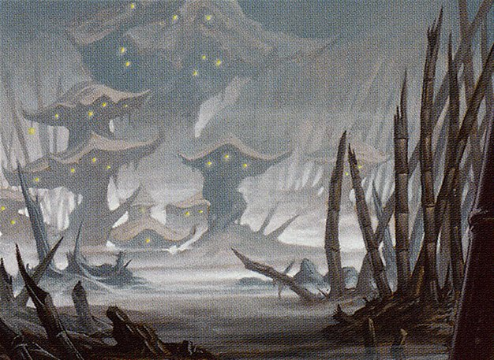
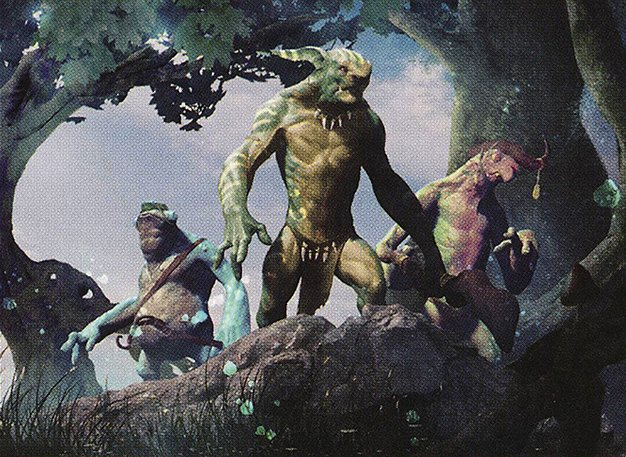
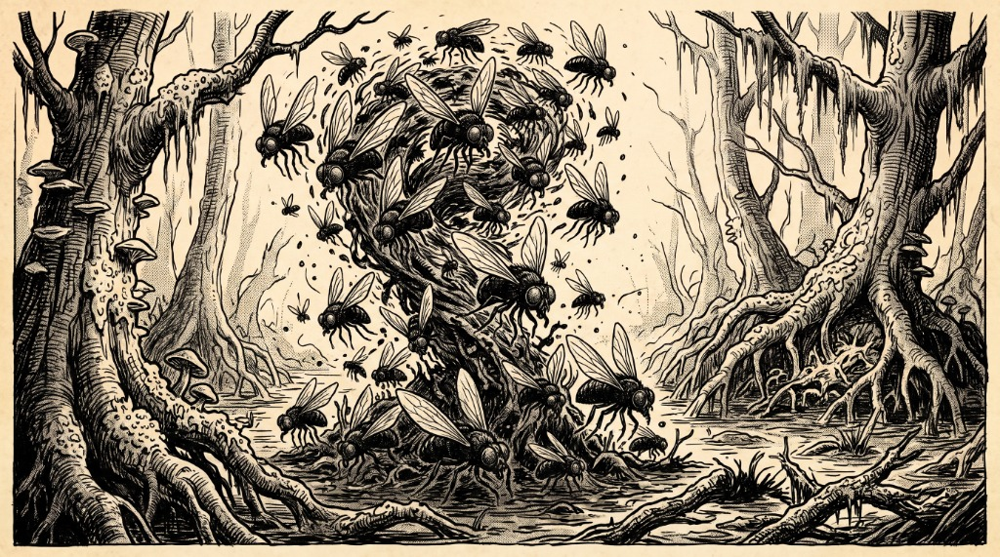
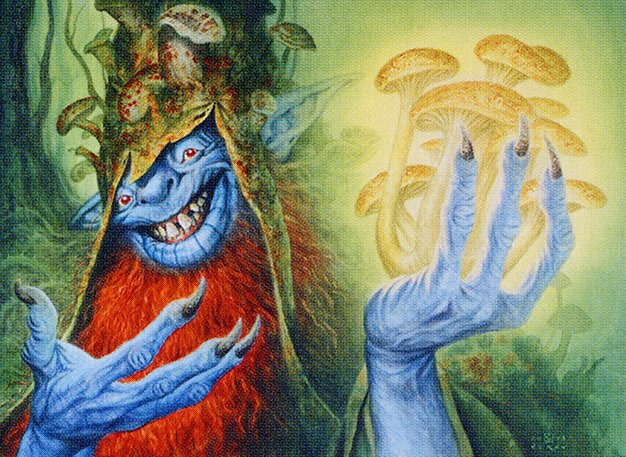
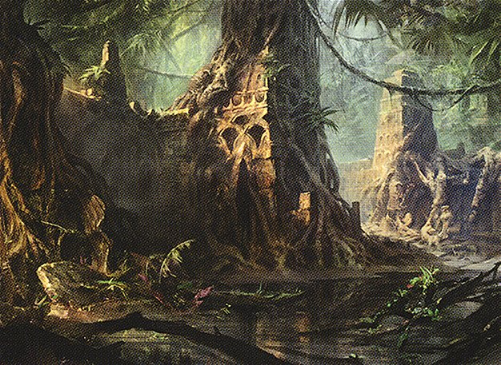

# Wiki do Vale da Lama

<blockquote class="epigraph">"Na névoa onde o fogo perde a voz e o ferro apodrece em silêncio, nada pertence a quem caminha. A água cobra o peso do passo, a raiz lembra o rosto de quem passa, e o vale só poupa quem aprendeu a pedir antes de colher." — <a href="./NPCs/Zog" class="internal">Zog</a>, Voz-de-Esporo de Raiz-Funda</blockquote>

![[assets/capa-vale-da-lama.jpg]]

O **[[Geografia/Vale da Lama|Vale da Lama]]** é uma bacia pantanosa vasta, úmida e opressiva, onde a vida não luta contra o apodrecimento — ela nasce dele. Tudo o que morre no brejo alimenta algo novo, e as tribos locais organizam suas leis, ferramentas e religiões ao redor desse ciclo implacável.

## Explore o Vale da Lama

  

    
<a href="./Geografia/Lugares" class="internal">Geografia &amp; Mapa</a>

    

    
Regiões do pântano, santuários, ruínas antigas e fronteiras fora do vale.

    <ul>
      <li><a href="./Geografia/Vale-da-Lama" class="internal">Vale da Lama (Mapa e Guia)</a></li>
      <li><a href="./Geografia/Raiz-Funda" class="internal">Raiz-Funda</a> &amp; <a href="./Geografia/Jardim-Dourado" class="internal">Jardim Dourado</a></li>
      <li><a href="./Geografia/Lago-da-Grande-Tirana" class="internal">Lago da Grande Tirana</a></li>
      <li><a href="./Geografia/Ruinas-dos-Sem-Nome" class="internal">Ruínas dos Sem-Nome</a> &amp; <a href="./Geografia/Terras-Verdejantes" class="internal">Terras Verdejantes</a></li>
    </ul>
  

  

    
<a href="./Tribos/Tribos" class="internal">Tribos &amp; Povos</a>

    

    
As tribos goblins do pântano, seus ofícios, disputas e antigos senhores.

    <ul>
      <li><a href="./Tribos/Masca-Musgo" class="internal">Masca-Musgo</a> (Oeste) &amp; <a href="./Tribos/Jardineiros" class="internal">Jardineiros</a></li>
      <li><a href="./Tribos/Ferve-Alga-(Olhos-Vermelhos)" class="internal">Ferve-Alga (Olhos-Vermelhos)</a> (Nordeste)</li>
      <li><a href="./Tribos/Ventre-Inchado" class="internal">Ventre-Inchado</a> (Sul)</li>
      <li><a href="./Tribos/Tece-Pele" class="internal">Tece-Pele</a> (Nômades) &amp; <a href="./Tribos/Povo-Dragão" class="internal">Povo Dragão</a></li>
    </ul>
  

  

    
<a href="./Cosmologia/Cosmologia" class="internal">Cosmologia &amp; Deuses</a>

    

    
Divindades, leis espirituais, tabus e relíquias do pântano.

    <ul>
      <li><a href="./Cosmologia/Nyog'Sothep" class="internal">Nyog'Sothep</a> (<a href="./Cosmologia/Deus-Verdadeiro" class="internal">Deus Verdadeiro</a>)</li>
      <li><a href="./Deuses-Fera/Deus-Fera" class="internal">Deuses-Fera</a>: <a href="./Deuses-Fera/Karkinos" class="internal">Karkinos</a>, <a href="./Deuses-Fera/Sss'kar" class="internal">Sss'kar</a>, <a href="./Deuses-Fera/Mael'ra" class="internal">Mael'ra</a></li>
      <li><a href="./Deuses-Fera/Og'gath" class="internal">Og'gath</a>, <a href="./Deuses-Fera/Krr'tak" class="internal">Krr'tak</a> &amp; <a href="./Deuses-Fera/Suuhr" class="internal">Suuhr</a></li>
      <li><a href="./Cosmologia/Codigo-de-Honra-do-Fogo" class="internal">Código do Fogo</a> &amp; <a href="./Cosmologia/Lei-da-Troca" class="internal">Lei da Troca</a></li>
    </ul>
  

  

    
<a href="./NPCs/NPCs" class="internal">NPCs &amp; Criaturas</a>

    

    
Goblins de renome, figuras infames e outras criaturas notáveis do pântano.

    <ul>
      <li><a href="./NPCs/NPCs" class="internal">Diretório de NPCs</a> &amp; <a href="./Geografia/Raiz-Funda#moradores-e-líderes" class="internal">Moradores de Raiz-Funda</a></li>
      <li><a href="./Exilados/Exilados" class="internal">Exilados</a>: <a href="./Exilados/Brask" class="internal">Brask</a>, <a href="./Exilados/Nokk" class="internal">Nokk</a> &amp; <a href="./Exilados/Skrit" class="internal">Skrit</a></li>
      <li><a href="./Criaturas/Criaturas" class="internal">Criaturas &amp; Feras</a>: <a href="./Criaturas/Ulok" class="internal">Ulok</a>, <a href="./Criaturas/Pinça-de-Sal" class="internal">Pinça-de-Sal</a> &amp; <a href="./Criaturas/Rainha-Sanguessuga-de-Águas-Paradas" class="internal">Rainha-Sanguessuga</a></li>
    </ul>
  

  

    
<a href="./Historia/Historia" class="internal">História &amp; Tradições</a>

    

    
A queda dos antigos mestres, a linha do tempo e os ritos do vale.

    <ul>
      <li><a href="./Historia/Linha-do-Tempo" class="internal">Linha do Tempo do Vale</a></li>
      <li><a href="./Historia/A-Grande-Morte-Lenta" class="internal">A Grande Morte Lenta</a></li>
      <li><a href="./Historia/Cacada-Sagrada" class="internal">A Caçada Sagrada</a></li>
    </ul>
  

